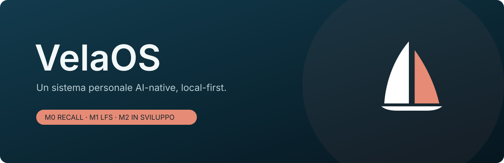
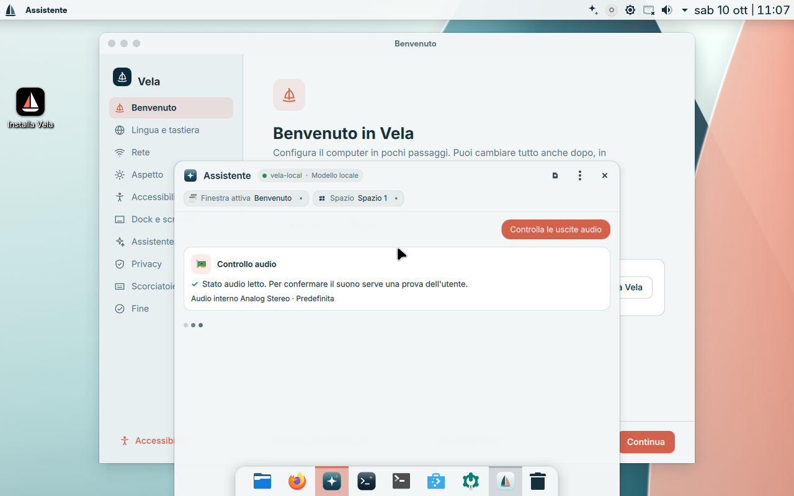
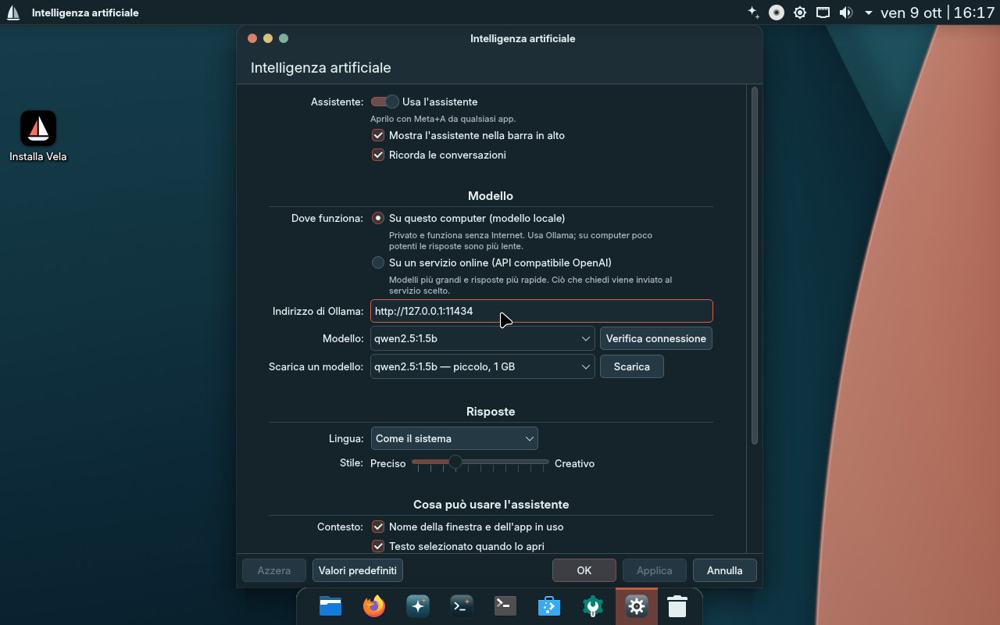
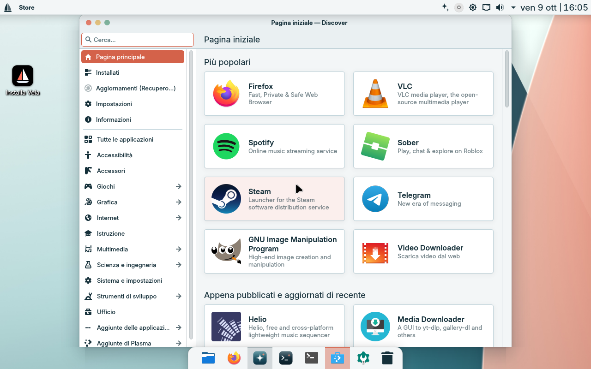
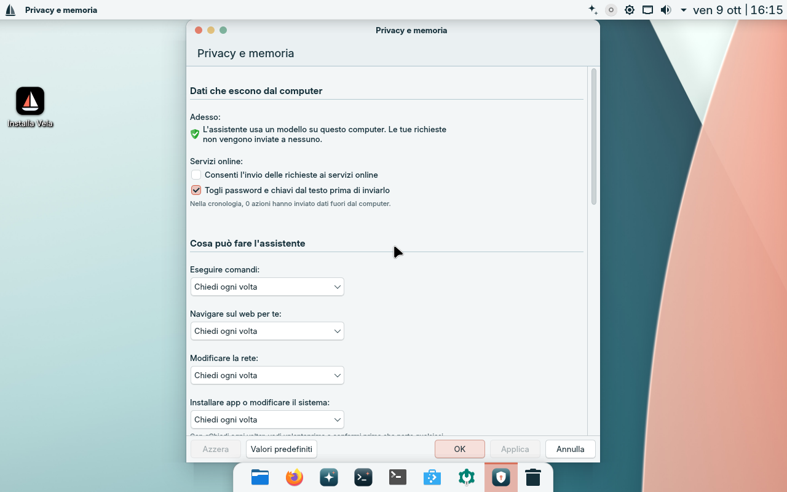
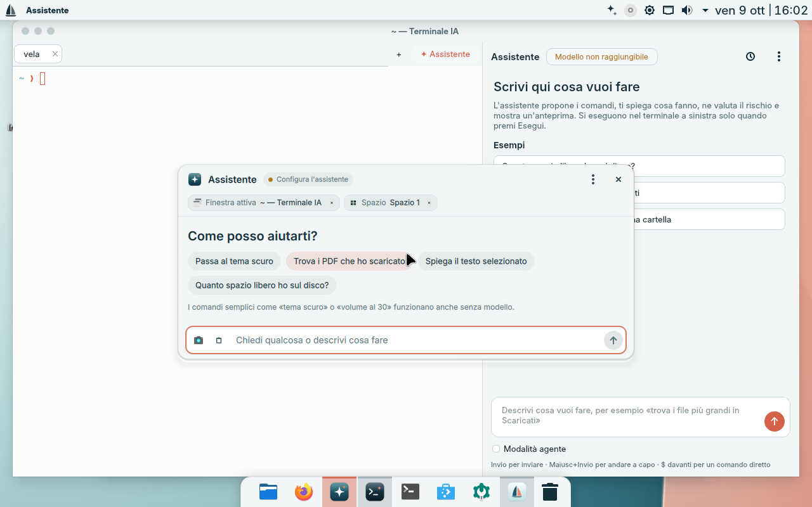
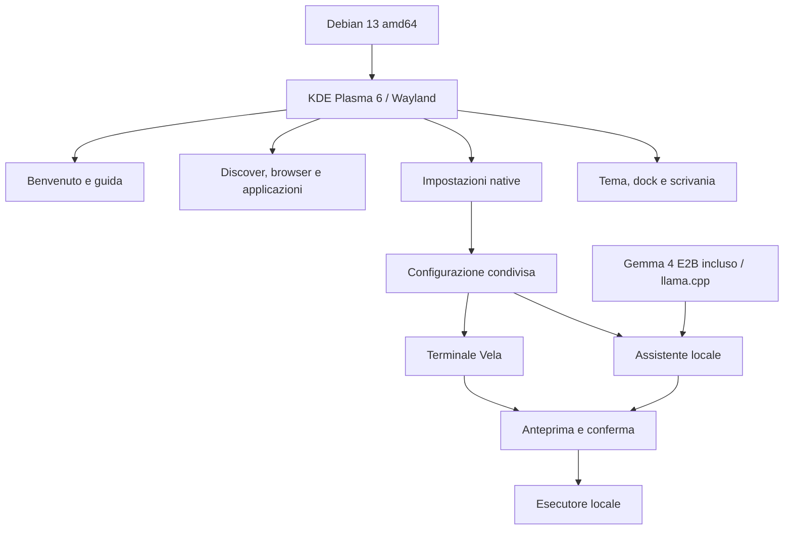

> **Nuova architettura — LFS + Neural Bus.** [M0: gate superato sulle 200 parafrasi sintetiche](poc/m0/GATE.md): recall@1 93%, p95 25,67 ms. [M1: nucleo LFS in Rust](poc/m1/README.md): gate dei 10.000 crash superato. Il trasporto sul Neural Bus è il lavoro successivo M2. Il desktop e le istruzioni seguenti documentano il prototipo precedente e non implementano la nuova architettura.

<p align="center"></p>

<p align="center">
<a href="https://github.com/FrySco19/VelaOS/releases">Download</a> ·
<a href="docs/BUILD.md">Compilare</a> ·
<a href="CONTRIBUTING.md">Contribuire</a> ·
<a href="https://github.com/FrySco19/VelaOS/discussions">Community</a> ·
<a href="docs/ROADMAP.md">Roadmap</a>
</p>

# VelaOS

[](https://github.com/FrySco19/VelaOS/actions/workflows/checks.yml)

VelaOS è un progetto aperto di sistema operativo per desktop, basato su **Debian 13 e KDE Plasma 6**. Riunisce un ambiente grafico coerente, impostazioni native, applicazioni, un terminale con esecuzione confermata e un assistente locale incluso per impostazione predefinita.

**Stato: preview di sviluppo.** Il desktop si avvia in VirtualBox e i componenti Vela sono integrati. Installazione su disco e compatibilità hardware estesa richiedono ancora collaudo. Le prove del modello e i loro limiti sono nel rapporto della release. Non è una versione stabile per sostituire il sistema principale.

**English:** An open desktop OS project built on Debian 13 and KDE Plasma 6. Native desktop integration, settings, applications and a bundled local Gemma 4 E2B assistant. Development preview; disk installation and physical hardware are not yet validated. See the release verification report for actual CPU inference measurements. Contributions in Italian and English are welcome.



## Dentro VelaOS

| Area | Componenti inclusi |
| --- | --- |
| Scrivania | Plasma Wayland, barra superiore, dock, tema chiaro/scuro, icone e sfondi Vela |
| Impostazioni | Moduli nativi per assistente, privacy, aspetto e aggiornamenti |
| Applicazioni | Discover/Flathub, Firefox ESR, strumenti per documenti e contenuti multimediali |
| Terminale | Konsole/fish e terminale Vela con PTY reale, anteprima e conferma dei comandi |
| Assistente | Pannello nativo, configurazione condivisa, integrazione browser e strumenti locali |
| Primo avvio | Benvenuto, guida, suggerimenti e scorciatoie |
| Sviluppo | Sorgenti, script ISO, strumenti VM, test e generatori delle risorse grafiche |

**Gemma 4 E2B e llama.cpp sono inclusi nella ISO.** L'assistente parte in locale,
senza account, chiavi cloud o download del modello al primo avvio. Propone
operazioni con anteprima e conferma: organizzazione di cartelle con registro e
ripristino, diagnosi/cambio uscita audio e installazione dal catalogo controllato.
Il download delle applicazioni richiede rete; le richieste al modello restano sul
computer. L'assistente si può disattivare dalle impostazioni.
[Funzionamento, limiti e schema dei flussi](docs/LOCAL_ASSISTANT.md).

## Schermate reali

| Impostazioni e privacy | Applicazioni e terminale |
| --- | --- |
|  |  |
|  |  |

Le immagini provengono dalla VM di collaudo. Non sono mockup. [Altre schermate e contesto](docs/SCREENSHOTS.md).

## Come è costruito



[Architettura e struttura dei sorgenti](docs/ARCHITECTURE.md).

## Provarlo

Scarica le parti della ISO, `ISO-PARTS.json` e `join-release.ps1` dalla sezione [Releases](https://github.com/FrySco19/VelaOS/releases). La preview pubblica disabilita l'accesso SSH di sviluppo e non contiene chiavi di accesso predisposte.

Su Windows metti tutte le parti e il manifest nella stessa cartella e avvia
`join-release.ps1`: verifica ogni parte e crea la ISO completa. Per VirtualBox,
scarica anche `Start-VM-Vela2.ps1` e avvialo nella cartella della ISO:

```powershell
.\Start-VM-Vela2.ps1 -Iso ".\VelaOS-2.1-local-preview.iso" -MemoryMB 8192
```

Leggi [la guida VirtualBox](VIRTUALBOX.md) prima di procedere. Per ricompilare da Debian 13, segui [BUILD.md](docs/BUILD.md). Le ISO sono asset delle release; non vengono salvate nella cronologia Git.

## Cosa è verificato e cosa manca

Avvio al desktop in VirtualBox, primo benvenuto, quattro pagine delle impostazioni, cambio tema, catalogo Store, ridimensionamento e protocollo dell'esecutore sono stati controllati. Sono disponibili **402 test terminale passati (3 saltati)**, **115 test assistente** e **13 controlli browser**, con i limiti descritti nel [resoconto delle verifiche](docs/VERIFICATION_LOCAL.md).

Restano da completare installer e ripristino del sistema, prove su hardware fisico, accessibilità, aggiornamenti affidabili, GPU e dispositivi mobili. Le misure CPU non garantiscono le prestazioni su altre macchine. Vedi [problemi noti](docs/KNOWN_ISSUES.md) e [roadmap](docs/ROADMAP.md).

## Costruiamolo insieme

Sono utili contributi a codice, design, traduzioni, accessibilità, documentazione e collaudo. Apri una [Issue](https://github.com/FrySco19/VelaOS/issues), partecipa alle [Discussions](https://github.com/FrySco19/VelaOS/discussions) o proponi una pull request. Parti dalla [guida ai contributi](CONTRIBUTING.md) e dalle attività `good first issue` / `help wanted`.

## Licenze

Il codice originale VelaOS 2 senza una licenza specifica nel file è distribuito sotto **GPL-3.0-or-later**; risorse e componenti con licenze proprie conservano tali licenze. Il prototipo storico e la sua presentazione in [`archive/`](archive/README.md) conservano MIT. Debian, KDE, applicazioni, font e firmware mantengono le rispettive condizioni: [LICENSE](LICENSE), [LICENSES](LICENSES/README.md), [THIRD_PARTY.md](THIRD_PARTY.md).

### Neural Bus bridge
The [Rust M0 → M1 bridge](poc/m2/README.md) now transfers capability-authorized LFS object bytes through real iceoryx2 shared memory between two processes. The [10,000-message report](poc/m2/bridge-results.json) verifies integrity; M2 performance and process-isolation gates remain open.
