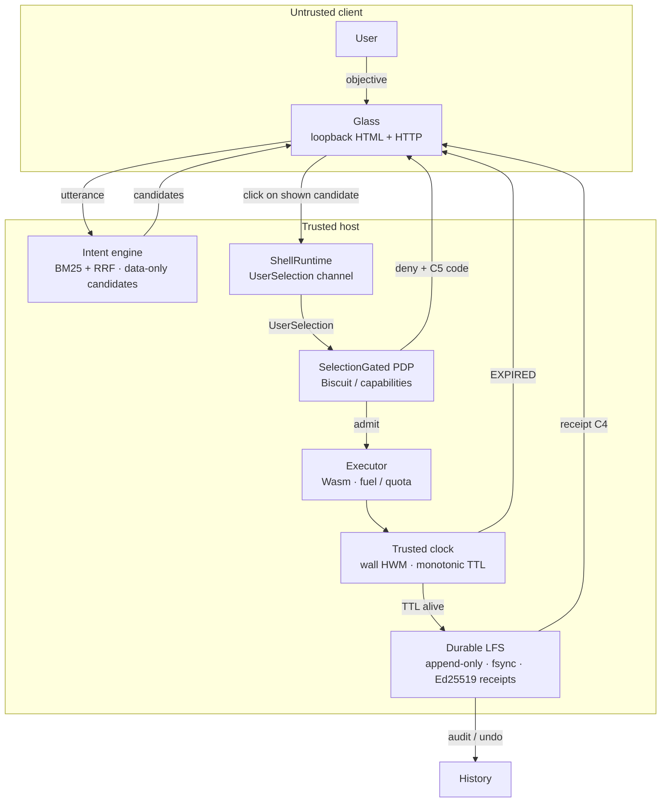
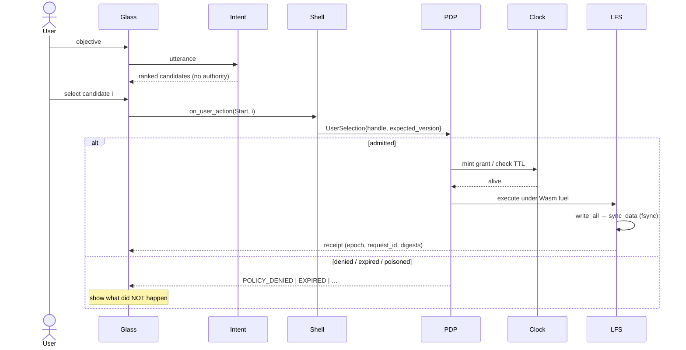
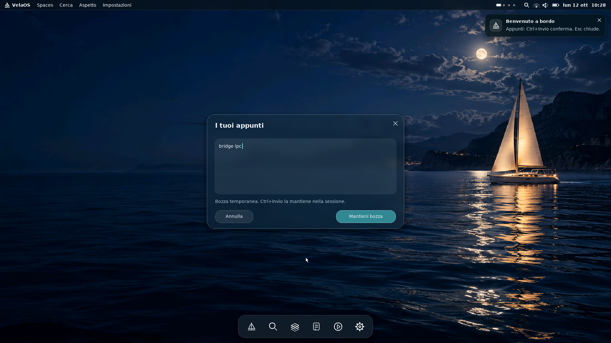

# VelaOS

[](LICENSE)
[](https://www.rust-lang.org/)
[](#status-and-roadmap)
[](#getting-started)

> **One-line:** State a goal. Review a proposal. Select an object. Let policy admit or deny. Persist only what a trusted clock and a durable ledger will stand behind.

VelaOS is an operating-system research stack whose center of gravity is **authority**, not chat. The model helps you think. It never holds the keys. What you can run today is a host demonstration of that contract — Glass over a loopback bridge, a real Wasm executor path, a selection-gated PDP, a trusted clock for grant TTL, and an append-only LFS with `fsync` before any receipt is returned.

This is not a daily-driver desktop yet. It is a systems artifact: contracts, deny codes, crash gates, and a UI that refuses to look like an LLM speaking for you.

The [native convergence audit](docs/NATIVE_CONVERGENCE.md) separates the x86 Glass
preview, Microkit guest and host runtime, and defines the delivery gates toward
a native workstation. The [Rust storage core](poc/storage-core/README.md) now has
a tested Microkit VirtIO adapter with signed recovery across two QEMU boots.
The live native Glass/LFS flow remains open. **v0.1.0** releases this bounded
Zero-Trust persistence milestone, with host-issued authorization fixtures.

**Native approval verification — tested:** the shared allocation-free Rust
`no_std` UserSelection verifier now runs in a Microkit PCB test domain using
`ed25519-dalek`. A six-domain AArch64 QEMU image verifies real shared-buffer
notification transport, accepts one signed selection and rejects corrupted
signatures and altered hashes: **37 baseline + 9 selection markers**, no
panic/fault. See the [QEMU evidence](docs/SELECTION_IPC_QEMU_REPORT.md).
The sender and emitted authorization are test fixtures; production human-input
attestation, Biscuit issuance and the live Glass-to-guest transport remain open.
The [implementation proposal](docs/HOST_GUEST_BRIDGE.md) defines that next bridge.

---

## Vela Soft contextual interface

The new Piega interface adapts to notes, study, audio, code and connection contexts. Notes use the signed native persistence flow; the other current tools have explicit host boundaries. See [implemented behavior and verification](docs/CONTEXTUAL_GLASS_STATUS.md). Start the configured Windows development environment with `vela-up.bat`. This is a working hosted MVP, not a complete laptop operating system.

## Vision

Personal computing should feel like working with a competent colleague who **shows their work** — and who cannot sign for you.

Most “AI OS” pitches collapse into a chat surface that silently mutates the world. VelaOS inverts the stack:

1. You state an **objective**.
2. Retrieval proposes **candidates** (data only — handles, versions, scores, sources).
3. You make an explicit **selection** (gesture → `UserSelection`).
4. A **policy decision point** admits or denies the exact envelope.
5. An executor runs under **fuel / quota**, against a **trusted clock**.
6. Effects that matter land in a **durable ledger** only after `fsync`.
7. You get a **result**, a **receipt**, and an audit trail — or a clear statement of what did *not* happen.

Local by default. Network and remote effects are plan steps you can see and revoke, never background surprises. The interpreter that drafts a plan is not the authority that commits it.

The destination is a machine where **goals replace app grids**, **proposals are first-class**, **failure is honest**, and **provenance beats polish**.

---

## Principles

These are load-bearing. A change that violates one is not a polish PR — it is a security regression.

| # | Principle | Implication |
| --- | --- | --- |
| 1 | **AI interprets; it does not authorize.** | The model may rank and annotate. It cannot grant, sign, widen scope, or “confirm on your behalf.” Prompt text that claims authority is ignored. |
| 2 | **The user selects; policy decides.** | A trusted shell records `UserSelection { handle, expected_version }` from a real gesture. The PDP admits or denies that envelope. User confirmation ≠ policy decision. |
| 3 | **Everything is a proposal until admitted.** | UI rule: AI output is labeled **Proposal**. Outcomes are labeled **Policy decision** with a stable code. A proposal never wears a decision’s colors. |
| 4 | **Permissions are narrow, timed, revocable.** | Each grant is *operation · object · duration*. Defaults are short-lived. Scope attenuates; it never expands past the token. |
| 5 | **Fail closed; recover visibly.** | Missing trusted time, poisoned store, expired/revoked grant, or an ambiguous post-crash outcome → no silent retry that repeats effects. |
| 6 | **Provenance over polish.** | Results carry input versions, digests, and receipts. Generated text is marked **generated** and is never presented as the original object. |
| 7 | **Keyboard-first, accessible, offline-capable.** | Primary actions without a mouse. Contrast, reduced motion, and screen-reader labels are part of the contract. No local interpreter → manual / template mode. |
| 8 | **The page is not trusted.** | Glass may send an utterance or a click on a *shown* candidate — never a forged handle or version. Authority lives in the shell and PDP, not in HTML. |

---

## Architecture

### Control flow



### Sequence: admit → execute → persist



### Trust boundary

| Trusts | Does not trust |
| --- | --- |
| Shell gesture → `UserSelection` | Glass HTML / JS |
| PDP admission frame | Model output / “rationale” text |
| Monotonic clock for grant TTL | Wall-clock jumps that would extend a grant |
| LFS signature under pinned key | Unsynced buffers; torn tails are truncated, not invented |
| Deny codes (C5) as the user-visible truth | Silent retries after `AMBIGUOUS` |

### Layers

| Layer | Responsibility | Non-goals |
| --- | --- | --- |
| **Glass** | Local translucent UI; proposal / decision labeling; loopback-only bridge | Authority, network bind, forged handles |
| **Intent** | Utterance → ranked candidates; retrieval + fusion | Any authority type (compile-fail boundaries) |
| **Shell** | Owns the trusted selection channel; routes gesture → PDP | Signing, token minting, bypassing denials |
| **PDP / policy** | Admit/deny, grants, fuel, deny codes | Treating AI text as a decision |
| **Trusted clock** | Wall high-water mark; grant TTL on monotonic time | Extending grants across clock regression |
| **Durable LFS** | Authenticated append-only receipts; `fsync` before return; fail-closed poison | Pretending an unsynced write committed |

Wire contracts (envelopes, receipts, deny codes) are versioned independently of the UI. Guest and host share the same semantic vocabulary so a denial on metal means the same thing as a denial in the host demo.

---

## UX: Glass

Glass is the current face of the zero-app model: one objective field, not an endless thread.

**What you see**

- Candidates ranked with provenance pills (source, version, score) — labeled **Proposal**.
- Plan steps you can review; sensitive writes demand an explicit confirmation that restates the effect.
- Policy outcomes as **Policy decision** with a stable code — never styled like a model success.
- Themes: Light · Dawn · Deep.
- Permanent honesty about locality: this demo is loopback-only.

**What the longer contract specifies** (documented; not all shipped)

Ephemeral workspace panels: Objective · Plan · Objects & provenance · Authorization · Result · History — plus global audit (`Ctrl+H`) and a permissions panel with revoke. Keyboard map, accessibility, and offline/manual fallback are part of that spec.

**Anti-patterns (forbidden)**

Chat-only UI · silent actions · LLM-as-authority · generic “OK” on destructive steps · perpetual global permissions · hiding a policy denial behind an automatic retry · presenting generated text as original content.

---

## Status and roadmap

Evidence below is from the host / QEMU verification path as of October 2026. “Done” means **demonstrated and gated**, not “shipped product.”

### Phase 1 — Done

Foundation of the authority story on the host:

- End-to-end QEMU bridge verification (historical marker set included in the Phase 2 E2E run).
- Real Wasm executor with fuel / quota enforcement.
- **M-G1b**: selection-gated PDP — planner output cannot become a `UserSelection`; AI-only paths → `POLICY_DENIED`.
- Intent engine with compile-time boundary tests (no authority types leak into retrieval).
- Glass host demo: loopback HTML + HTTP, proposal → click → shell → PDP.
- UX zero-app contracts and reproducible flows (read / write / deny).

### Phase 2 — Done · Zero-Trust persistence milestone v0.1.0

Closed on the verification path:

| Gate | Result |
| --- | --- |
| Policy suite | **69 / 69** |
| QEMU `verify-bridge-e2e` | **PASS · 37 markers** (no panic / FAULT; prohibited markers absent) |
| Crash gate (process abort, 200 runs) | **0** lost announced receipts · **0** double effects · torn tails truncated |
| Grant TTL | Wall cannot walk backward to extend a grant; monotonic check before execute **and** before LFS commit |
| Guest VirtIO persistence | **41 + 5 markers**, two separate QEMU boots, signed note/receipt recovered; bounded test-domain backend |
| Durable LFS (host) | Append-only ledger; authenticated receipts; `write_all` → `sync_data` → *then* return receipt; poison fails closed |
| Epoch | Persistent across boots; unclean prior session stays **AMBIGUOUS** until reconciled |

**Still open inside Phase 2’s shadow (honest):**

- The default E2E remains volatile; the hardware feature now persists a bounded signed snapshot through VirtIO. Complete immutable/encrypted guest LFS and native Glass integration remain open.
- No RTC / TPM root for absolute time across reboot.
- Guest writer trusts the PCB’s deadline check (same model as the notary); pre-boot time is not visible to the guest.
- Production trust roots (demo seeds only); `result_handle` / `expected_version` on the write path (**M-LFS-5**) still open.
- Real power-loss with disk cache: simulated via process abort, not bare metal.

### Phase 3 — Packaging available · hardware qualification next

1. **Reproducible QEMU packaging** — available through the Windows wrapper or `make e2e`; requires Rust and Docker/BuildKit and checks every required serial marker. See [packaging prerequisites and evidence](packaging/e2e/README.md).
2. **Bare-metal Raspberry Pi 4** — authority + durable path on device; power-loss and clock behavior on metal.
3. **Release hygiene** — changelog and tag **`v0.1.0`** when packaging is credible (not before).

Hardware qualification remains open. v0.1.0 packages the bounded persistence milestone, not a daily-driver OS. Treat the host Glass demo as the public face and the QEMU E2E as the bounded prototype proof.

---

## Getting started

### One-command native boot (v0.1.0)

```sh
bash run-velaos.sh
# equivalent: make boot
```

On Windows with Rust and Docker in WSL Debian:

```powershell
powershell -ExecutionPolicy Bypass -File scripts\verify-bridge-e2e.ps1 -Hardware
```

The launcher builds pinned seL4/Microkit and Rust domains, then checks **41 markers
on the first QEMU boot and 5 on a separate cold boot** against the same VirtIO
disk. The appunto and signed receipt survive; the idempotent retry leaves its
SHA-256 unchanged. [Evidence and exact boundaries](docs/LFS_HARDWARE_LOCAL.md).

Requires Cargo, Docker/BuildKit and Python 3. A first SDK/toolchain build may take
15–40 minutes; **a sub-three-minute cold launch is not established**. Cached
launch speed depends on the machine and cache. This is a serial QEMU proof, not
the graphical x86 Glass desktop. Linux is a build host/container only.
UserSelection/Biscuit remain host fixtures; production trust roots, full guest
LFS, native Glass storage, RTC/TPM and physical hardware remain open.

### Prerequisites

- Rust toolchain ≥ the workspace `rust-version` (Glass crate: **1.90+**), with `cargo`.
- A checkout that contains `poc/product/glass` and its path dependencies (`vela-intent`, `vela-shell`, `vela-m0-recall`, executor policy / host).
- Optional but recommended for full recall lanes: a local M0 directory with `bridge_recall.py`, `.venv`, and `.model-cache`.

### Run Glass (host demo)

From the repository root:

On Windows, use the launcher with your prepared local M0 directory:

```bat
scripts\launch-glass.bat "C:\path\to\VelaOS-public\poc\m0"
```

Then open **http://127.0.0.1:7878/**. The launcher reports missing prerequisites rather than silently substituting a working semantic model. `scripts\launch-glass.bat --no-m0` explicitly selects the BM25-only demonstration.

The underlying Cargo command remains available:

```bash
cd poc/product/glass

# Full recall lanes (point --m0 at your VelaOS-public poc/m0 tree)
cargo run --offline --release -- --m0 /path/to/VelaOS-public/poc/m0

# Or without M0 — fixture / stub retrieval still exercises the authority path
# cargo run --offline --release --
```

The binary binds **loopback only** and prints the URL. Default port:

**http://127.0.0.1:7878/**

Override with `--port <n>` if needed. Open that URL in a browser on the same machine. Try an objective, review the **Proposal**, select a candidate, and watch admission or a deny code. There is no remote authority path in this demo.

If `cargo` cannot find the package, confirm you are inside `poc/product/glass` (package name `vela-glass`). Startup logs include the bound port and which recall lanes are active.

### What “good” looks like

1. Glass loads; theme dock works (Light / Dawn / Deep).
2. An utterance yields candidates — each clickable, none executable without selection.
3. Selecting a candidate either runs under a grant (receipt / request id) or surfaces a **Policy decision** with a C5 code.
4. An AI-only / planner-only attempt to act without a user selection is denied — by design.

---

### Verify the packaged QEMU bridge

On Windows:

```powershell
powershell -ExecutionPolicy Bypass -File scripts\verify-bridge-e2e.ps1
```

On Linux with Rust and Docker in the same environment:

```bash
make e2e
```

The runner requires 37 markers, denies panic/FAULT and prohibited expired-grant writes, and accepts the idle timeout only after the required checks. Full serial output and the verdict are saved under `.local/e2e/`. This is a bounded QEMU proof, not a Raspberry Pi qualification.

### Native Glass preview in VirtualBox

The [x86_64 preview](os/x86_64/README.md) boots directly into a photographic desktop with a familiar toolbar and small intent-focused Glass surfaces. Notes accept real keyboard input and can retain a draft for the current session; closing clears temporary UI buffers. The surface model is bounded Rust linked to the existing framebuffer renderer.



Run `os/x86_64/Start-VelaOS-VirtualBox.ps1` to boot `velaos-glass-x86_64.iso` in a BIOS VM with 512 MB RAM. Networking, audio playback, LLM inference and durable LFS are **not integrated into this native preview**; unavailable services are identified rather than simulated. It is separate from the AArch64 Microkit security proof and does not establish the whole-system RAM target.

## Component gates and seL4 port

[](https://github.com/FrySco19/VelaOS/actions/workflows/lfs-m1.yml)
[](https://github.com/FrySco19/VelaOS/actions/workflows/neural-bus-m2.yml)

The sections below track the component gates (M0–M5) and the seL4 protection-domain port that run alongside the Phase 1–2 authority path described above.

### Component gate status

| Gate | Status | Scope and evidence |
| --- | --- | --- |
| M0 — semantic recall | **CLOSED** | Hybrid-recall gate passed on a synthetic fixture: 186/200 paraphrases (93% recall@1), p95 25.67 ms. This does not establish quality on personal data. |
| M1 — LFS authority | **CLOSED** | Rust storage prototype with encrypted objects, signed commits, and Biscuit-bound capabilities; crash gate recorded over 10,000 process terminations. Not a distributed or production storage service. |
| M2 — IPC and WASM | **CLOSED** | Dual-lane IPC and WASM prototype tests cover typed transport, authorized reads, and adversarial traps. Current host-native peer isolation and durable bulk-file integration are not complete. |
| M3 — intent routing | **CLOSED** | Constrained local intent router, finite templates, deterministic Rust policy, and capability revalidation at cache hits. It remains a prototype and does not authorize operations by model output. |
| M4 — recovery and SLM footprint | **CONDITIONALLY CLOSED** | Persistent provider, confirmation, rollback and live hybrid-recall integration tests pass. Streaming CUDA loading replaces rejected mmap; measured worker peak working set 589 MB, active private commit 4.55 GB. Full-system qualification remains pending. |
| M5 Gate A — reproducible seL4 boot | **CLOSED** | The pinned Microkit 2.3.0 image built and booted the AArch64 seL4 guest in QEMU. |
| M5 Gate B — domain isolation | **IN PROGRESS** | Five statically declared protection domains with separate ELFs, CSpaces, and VSpaces now build and boot. Capability manifests, restricted authority, negative reachability tests, and crash/restart tests remain. |
| M5 Gate C — PCB capability derivation | **IN PROGRESS** | A separately booted custom seL4 root task creates a live child with isolated CSpace/VSpace, mints a badged send capability into its CSpace, receives and verifies the child’s IPC badge, replies, then deletes the grant and suspends the child. Biscuit validation, policy profiles, timed leases, and deny/revocation tests remain. |
| M5 Gate D — bounded Wasm executor | **IN PROGRESS** | The executor PD runs Wasmi 2.0.0 without `std` or WASI. QEMU verifies a 10M fuel budget, fuel-exhaustion trap, 64 KiB memory cap, and a 16 KiB Wasm stack bound; task IPC, epoch deadlines, concurrency, and cancellation remain. |
| M5 Gate E — bus/LFS integration | **IN PROGRESS** | A fixed intent traverses Orchestrator → PCB → Bus → Executor → LFS using Microkit protected calls; the executor returns 42 and the LFS PD records it in volatile memory. Biscuit authorization, dynamic-grant wiring, durable LFS, and adversarial E2E cases remain. |
| M5 Gate F — benchmark preparation | **IN PROGRESS** | QEMU boots and the serial-marker timing harness records host-observed intervals for the fixed flow. These are single-run diagnostic samples, not guest-only latency or qualification against the 250 ms target. |
| M5 Gate G — security review | **IN PROGRESS** | A residual-risk and resource-accounting report is published; this is not an independent security audit or a security qualification. |

“Closed” for M0–M3 refers to the stated component-gate scope; it does not mean
those components have been integrated into a complete seL4 operating system.
Gate B currently proves the static five-domain boot structure only. M4 remains
conditional until its outstanding system and hardware measurements are
completed. See [runtime status and limitations](docs/RUNTIME_STATUS.md).
Gate C's root-task proof boots as a separate seL4 image; it is not part of the
five-domain Microkit image. It demonstrates live capability derivation and an
IPC round-trip, but not Biscuit validation or the complete policy broker.
Gate D's fixed Wasm probe runs in the five-domain Microkit image with no
WASI or host imports; Gate E connects it to a fixed bus/LFS task flow.
Gate E connects those domains for one deterministic demonstration flow, but
its PCB uses a fixed label rule and its LFS write is volatile, not durable.
Gate F's timing method observes serial-marker intervals on the QEMU host
because the pinned kernel traps EL0 reads of `CNTVCT_EL0`; neither those
host-observed values nor the artifact sizes are whole-system RAM/latency
qualification. See [the Gate F/G report](GATE_F_G_REPORT.md) for the run data,
resource estimates, and residual risks.

### Gate A: reproduce the QEMU boot

From the repository root, with Docker available:

```powershell
docker build -f poc/m5_sel4/Dockerfile -t velaos-gate-a poc/m5_sel4
docker run --rm -it velaos-gate-a
```

The image pins seL4 Microkit 2.3.0, `rust-sel4` v5.0.0, and its matching Rust
nightly. The guest prints Wasm verification and the completed fixed intent to QEMU's serial output.
Use `Ctrl+A`, then `X` to exit QEMU. This smoke test does not validate Gate B
isolation or physical hardware behavior. See the [Gate A README](poc/m5_sel4/README.md)
for toolchain details and scope.

### Boot the published QEMU preview image

Download `velaos-qemu-loader.img` and `velaos-qemu-loader.img.sha256` from the
[VelaOS 2.2 runtime/QEMU preview release](https://github.com/FrySco19/VelaOS/releases/tag/v2.2-runtime-preview)
into the same directory. On WSL/Linux, install QEMU if needed and verify the
image checksum before boot:

```bash
sudo apt install qemu-system-arm
sha256sum -c velaos-qemu-loader.img.sha256
qemu-system-aarch64 \
  -machine virt,virtualization=on \
  -cpu cortex-a53 \
  -m 2G \
  -nic none \
  -serial mon:stdio \
  -nographic \
  -device loader,file=velaos-qemu-loader.img,addr=0x70000000,cpu-num=0
```

The QEMU release image is not `pcb-root.img`: that filename belongs to the
separate Gate C root-task proof. Exit QEMU with `Ctrl+A`, then `X`. The preview
guest is a development demonstration with volatile LFS state, not an installable
or security-qualified OS.

### Repository map

| Path | Contents |
| --- | --- |
| [`poc/m0/`](poc/m0/GATE.md) | Semantic recall experiment and fixture results. |
| [`poc/m1/`](poc/m1/README.md) | Rust LFS storage and capability-bound operations. |
| [`poc/m2/`](poc/m2/README.md) | Neural Bus, typed IPC, and WASM boundary prototypes. |
| [`poc/m3/`](poc/m3/README.md) | Local intent routing, deterministic policy, and evaluation corpus. |
| [`poc/m4/`](poc/m4/README.md) | Recovery coordinator, persistent provider, and rollback supervisor. |
| [`poc/m5_sel4/`](poc/m5_sel4/README.md) | Microkit/Rust/QEMU domain, capability, bounded Wasm and fixed-flow proofs. |
| [`GATE_F_G_REPORT.md`](GATE_F_G_REPORT.md) | Gate F timing observations and Gate G resource/residual-risk review. |
| [`docs/M5_DESIGN.md`](docs/M5_DESIGN.md) | Proposed seL4 protection-domain architecture and M5 acceptance gates. |
| [`docs/RUNTIME_STATUS.md`](docs/RUNTIME_STATUS.md) | Runtime evidence, measurements, and outstanding limitations. |
| [`archive/`](archive/README.md) | Historical web-shell prototype. |

`components/` and `build/` contain the previous Debian/KDE preview and do not
implement the new AI-native architecture.

---

## Contributing

VelaOS is careful systems work. Reviewers will reject “helpful” shortcuts that skip selection or policy.

1. **Read the principles** before changing UX or the admit path.
2. **Keep authority out of the model and out of the page.** If AI text can be mistaken for a decision, the change is wrong.
3. **Touch boundaries with tests.** Intent must not gain authority types. Glass must not accept forged handles. PDP deny codes stay stable or get an explicit migration note.
4. **Document failure modes.** New deny / error paths need user-visible copy that states what did *not* happen.
5. **Small, reviewable diffs.** Prefer one invariant per PR.
6. **No push to `main`, no force-push, no release tag** without an explicit go-ahead from the maintainer. Feature work lands on an agreed branch; packaging and tags are coordinated.

Issues and design discussion: use the repository issue tracker once the public tree is the source of truth. Until a `v0.1.0` tag exists, treat host demo + QEMU E2E logs as the ground truth.

---

## License

Copyright (c) VelaOS contributors.

Licensed under the **GNU General Public License v3.0 only** (`GPL-3.0-only`), except where individual files state otherwise.

See [`LICENSE`](LICENSE) for the full text. Third-party components retain their own licenses; see `THIRD_PARTY.md` when present in the tree.

---

## Document status

Published project overview. Architecture diagrams describe the stated host-demo and prototype boundaries; they do not imply a complete production OS. Phase labels follow verification evidence, not marketing.
