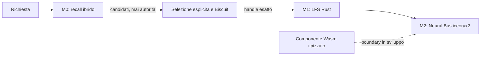

# VelaOS

**Un sistema operativo personale AI-native, local-first e verificabile.** VelaOS esplora un'architettura in cui il richiamo semantico propone candidati, le capability determinano l'autorità, lo storage mantiene oggetti immutabili e un bus tipizzato trasporta i dati. I componenti correnti sono prototipi di ricerca, non un sistema operativo integrato o una release installabile.

**English:** VelaOS is an open AI-native personal OS research project. Its current work explores semantic retrieval, capability-secured immutable storage, typed IPC, and isolated Wasm tasks. M0 and M1 gates have recorded passes; M2 remains in progress. This repository does not yet provide an integrated or production-ready OS.

## Stato dei gate

| Fase | Stato | Evidenza e limiti |
| --- | --- | --- |
| M0 — richiamo ibrido | Gate superato sul fixture sintetico | 186/200 parafrasi (93% recall@1), p95 25,67 ms. Non misura qualità su dati personali reali. [Risultati e limiti](poc/m0/GATE.md) |
| M1 — storage LFS | Gate crash superato | Kernel Rust con oggetti cifrati, commit firmati e capability Biscuit; gate registrato su 10.000 terminazioni di processo. Non è ancora un servizio di storage distribuito. [Implementazione e validazione](poc/m1/README.md) |
| M2 — isolamento e throughput | In corso | Bridge Rust con IPC iceoryx2 tra processi reali: 62.222 messaggi/s e p99 round-trip 17 µs nel test sequenziale da 4 KiB. Il target >100.000 msg/s e l'isolamento del peer non sono dimostrati. Il boundary Wasmtime è scritto, ma build e test non sono ancora confermati. [Stato M2](poc/m2/README.md) |

I numeri descrivono test locali specifici, non garanzie di prodotto. In particolare, il test M2 è ping/ack sequenziale, non throughput pipelined; il trasferimento dallo storage al loan IPC effettua una copia. Il progetto non è pronto per dati sensibili o uso come sistema principale.

## Architettura in breve

Il modello non concede permessi e non risolve direttamente gli oggetti. Il codice di policy valida le capability e l'handle prima di ogni accesso. Il componente Wasm usa un contratto WIT tipizzato e un linker senza WASI; l'integrazione end-to-end e la verifica del build sono ancora aperte. [Architettura e confini](docs/ARCHITECTURE.md) · [Roadmap dei gate](docs/ROADMAP.md) · [Limiti noti](docs/KNOWN_ISSUES.md).

## Codice e riproduzione

| Percorso | Contenuto |
| --- | --- |
| [`poc/m0/`](poc/m0/README.md) | Esperimento di semantic hybrid recall; Python è confinato a questo spike. |
| [`poc/m1/`](poc/m1/README.md) | Kernel storage Rust: canonicalizzazione, cifratura, commit firmati e handle capability-bound. |
| [`poc/m2/`](poc/m2/README.md) | Bridge Neural Bus Rust/iceoryx2 e boundary Wasmtime in sviluppo. |
| [`archive/`](archive/README.md) | Prototipo storico della shell web. |
| `components/`, `build/` | Sorgenti e pipeline della precedente preview Debian/KDE; non implementano l'architettura M0-M2. |

Rust 1.90 o successivo. Per riprodurre i controlli si usano i manifest dei singoli crate; i comandi e i prerequisiti sono nei rispettivi README. Il build Wasmtime non è stato ancora verificato in locale al 2026-10-10. La guida [BUILD.md](docs/BUILD.md) riguarda la vecchia preview desktop e lo dichiara esplicitamente.

## Contribuire

Issue, review di sicurezza, test riproducibili e documentazione dei limiti sono particolarmente utili. Vedi [CONTRIBUTING.md](CONTRIBUTING.md), [Security](SECURITY.md) e [Code of Conduct](CODE_OF_CONDUCT.md). Le licenze del codice e degli artefatti storici sono descritte in [LICENSE](LICENSE), [LICENSES](LICENSES/README.md) e [THIRD_PARTY.md](THIRD_PARTY.md).

## Progetto precedente

La preview Debian 13/KDE Plasma, con assistente desktop locale, resta nel repository come linea storica e non è il sistema costruito dai gate M0-M2. Le relative schermate, note e procedure non costituiscono prove dell'architettura AI-native. Consulta [le note storiche della release](RELEASE_NOTES.md) e la [documentazione desktop](docs/BUILD.md).
