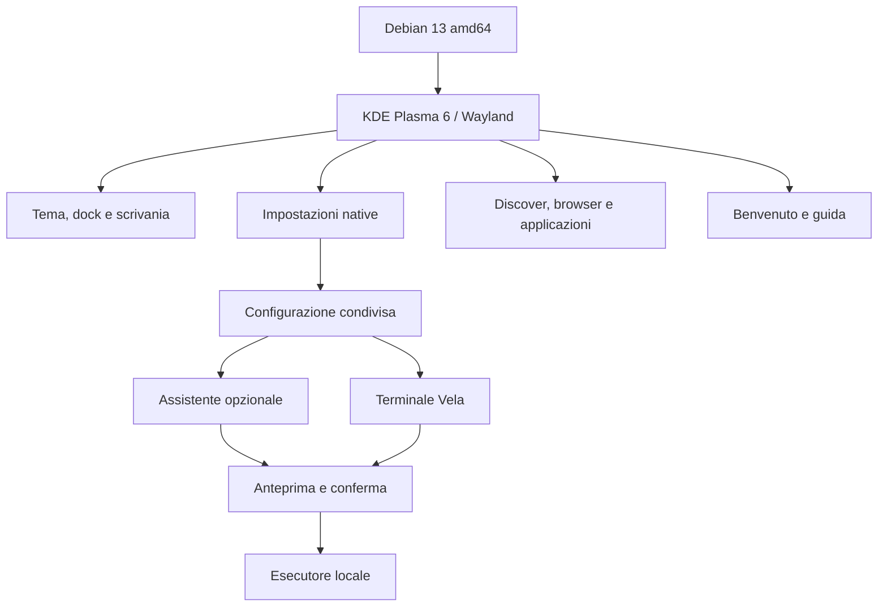

<p align="center"></p>

<p align="center">
<a href="https://github.com/FrySco19/VelaOS/releases">Download</a> ·
<a href="docs/BUILD.md">Compilare</a> ·
<a href="CONTRIBUTING.md">Contribuire</a> ·
<a href="https://github.com/FrySco19/VelaOS/discussions">Community</a> ·
<a href="docs/ROADMAP.md">Roadmap</a>
</p>

# VelaOS

VelaOS è un progetto aperto di sistema operativo per desktop, basato su **Debian 13 e KDE Plasma 6**. Riunisce un ambiente grafico coerente, impostazioni native, applicazioni, un terminale con esecuzione confermata e un assistente configurabile.

**Stato: preview di sviluppo.** Il desktop si avvia in VirtualBox e i componenti Vela sono integrati. Installazione su disco, compatibilità hardware estesa e inferenza con un modello reale richiedono ancora collaudo. Non è una versione stabile per sostituire il sistema principale.

**English:** An open desktop OS project built on Debian 13 and KDE Plasma 6. Native desktop integration, settings, applications and an optional configurable assistant. Development preview; real hardware, disk installation and real-model inference are not yet validated. Contributions in Italian and English are welcome.


## Dentro VelaOS

| Area | Componenti inclusi |
| --- | --- |
| Scrivania | Plasma Wayland, barra superiore, dock, tema chiaro/scuro, icone e sfondi Vela |
| Impostazioni | Moduli nativi per assistente, privacy, aspetto e aggiornamenti |
| Applicazioni | Discover/Flathub, Firefox ESR, strumenti per documenti e contenuti multimediali |
| Terminale | Konsole/fish e terminale Vela con PTY reale, anteprima e conferma dei comandi |
| Assistente | Pannello nativo, configurazione condivisa, integrazione browser e strumenti locali |
| Primo avvio | Benvenuto, guida, suggerimenti e scorciatoie |
| Sviluppo | Sorgenti, script ISO, strumenti VM, test e generatori delle risorse grafiche |

L'assistente è opzionale. **Il motore e il modello non sono preinstallati**: la configurazione locale prevista usa Ollama; è disponibile anche una connessione online compatibile con OpenAI, su scelta dell'utente. Le prove con server simulato verificano i protocolli, non la qualità o la velocità di un modello reale.

## Schermate reali

| Impostazioni e privacy | Applicazioni e terminale |
| --- | --- |
|  |  |
|  |  |

Le immagini provengono dalla VM di collaudo. Non sono mockup. [Altre schermate e contesto](docs/SCREENSHOTS.md).

## Come è costruito



[Architettura e struttura dei sorgenti](docs/ARCHITECTURE.md).

## Provarlo

Scarica ISO e checksum dalla sezione [Releases](https://github.com/FrySco19/VelaOS/releases). La preview pubblica disabilita l'accesso SSH di sviluppo e non contiene chiavi di accesso predisposte.

Per VirtualBox su Windows, scarica anche `Start-VM-Vela2.ps1` e avvialo nella cartella della ISO:

```powershell
.\Start-VM-Vela2.ps1 -Iso ".\VelaOS-2.0-preview-public.iso" -MemoryMB 8192
```

Leggi [la guida VirtualBox](VIRTUALBOX.md) prima di procedere. Per ricompilare da Debian 13, segui [BUILD.md](docs/BUILD.md). Le ISO sono asset delle release; non vengono salvate nella cronologia Git.

## Cosa è verificato e cosa manca

Avvio al desktop in VirtualBox, primo benvenuto, quattro pagine delle impostazioni, cambio tema, catalogo Store, ridimensionamento e protocollo dell'esecutore sono stati controllati. Sono disponibili **401 test terminale passati (4 saltati)**, **52 test assistente** e **13 controlli browser**, con i limiti descritti nel [resoconto delle verifiche](docs/VERIFICATION.md).

Restano da completare inferenza reale, installer e ripristino, prove su hardware fisico, accessibilità, aggiornamenti affidabili e misurazioni delle prestazioni. Vedi [problemi noti](docs/KNOWN_ISSUES.md) e [roadmap](docs/ROADMAP.md).

## Costruiamolo insieme

Sono utili contributi a codice, design, traduzioni, accessibilità, documentazione e collaudo. Apri una [Issue](https://github.com/FrySco19/VelaOS/issues), partecipa alle [Discussions](https://github.com/FrySco19/VelaOS/discussions) o proponi una pull request. Parti dalla [guida ai contributi](CONTRIBUTING.md) e dalle attività `good first issue` / `help wanted`.

## Licenze

Il codice originale VelaOS 2 senza una licenza specifica nel file è distribuito sotto **GPL-3.0-or-later**; risorse e componenti con licenze proprie conservano tali licenze. Il prototipo storico in `archive/legacy-web-shell` conserva MIT. Debian, KDE, applicazioni, font e firmware mantengono le rispettive condizioni: [LICENSE](LICENSE), [LICENSES](LICENSES/README.md), [THIRD_PARTY.md](THIRD_PARTY.md).
