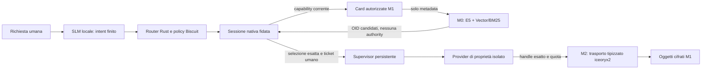

# Architettura corrente e confini verificati

VelaOS usa intent, query semantiche e OID/handle per gli oggetti. I percorsi del
repository sono infrastruttura di sviluppo, non il namespace degli oggetti utente.
Il runtime nativo Rust e il port seL4 sono oggi due prove distinte; il guest non
contiene ancora tutti i servizi del runtime persistente.

Il diagramma descrive responsabilità e collegamenti nativi. La sessione e il
richiamo reale sono verificati dai test; l'interfaccia e l'ingresso Bus di
produzione non sono ancora implementati. I test di sessione non chiamano il SLM.
Il compiler SLM è testato separatamente: l'intero percorso umano consumer non è
ancora qualificato.

## Control plane

Il modello compila solo `save`, `recall`, `restore`, `clarify` o `unsupported`.
Non emette codice eseguibile, capability, caller fidato o byte degli oggetti.
Il Router Rust controlla schema, contesto fidato e permessi; la cache ricontrolla
l'autorità a ogni uso. Il modello non può trasformare un'intenzione in authority.

M0 riceve card filtrate con la capability corrente, usa l'epoch E5 fissato e
restituisce OID ordinati. La sessione scarta OID estranei o duplicati. La scelta
esatta rimane un evento umano fidato, seguito da nuova autorizzazione nativa.
CONFIRM e KEEP consumano ticket privati diversi, associati alla sessione.

## Data plane e persistenza

M1 conserva oggetti canonici cifrati e commit firmati. M2 usa veri loan iceoryx2,
frame tipizzati, expiry e quote native. Il caricamento/decrittazione LFS e lo
staging nel loan comportano copie: non si dichiara zero-copy end-to-end. Le lane
fast e bulk hanno limiti di buffer/crediti; il bulk LFS durevole resta da integrare.
Nessun byte dell'oggetto passa attraverso il SLM.

Il provider M4 pubblica una head logica firmata nel dominio di prova isolato,
verifica l'OID dell'effetto e registra staging e recovery. Non configura un
dispositivo fisico e non dichiara atomicità tra database e hardware. Il supervisor
registra intent prima degli effetti e ripristina operazioni incompiute al riavvio.
L'autorità di rollback è vincolata alla transazione, dominio e coppia di OID;
resta utilizzabile dopo la scadenza del token utente e viene revocata a KEEP.

## Isolamento e port seL4

Il runtime M2 usa Wasmtime senza WASI e senza import ambientali, con limiti di
memoria, fuel e concorrenza. Il port no-std seL4 usa un executor Wasmi limitato
per il modulo dimostrativo: non è una portabilità già completata di Wasmtime.

QEMU avvia Orchestrator, PCB, Bus, Executor e LFS in cinque domini Microkit.
I canali statici completano un intent fisso con risultato 42. Il PCB del flusso
usa una regola di label, non Biscuit; il grant dinamico è provato in un'immagine
root-task separata. LFS nel guest è volatile. SLM/GPU, storage M1 durevole,
recovery, lease e driver consumer non sono ancora collegati al guest.

## Risorse e prove

Caricamento SLM streaming, tensor placement CUDA e scaricamento dopo 5s riducono
la residenza host nei campioni registrati. Il commit attivo resta circa 4,55 GB;
la RAM dell'intero OS sotto 1,5 GB non è dimostrata. Le misure del worker Windows,
la capacità guest QEMU e i tempi della seriale sono quantità diverse.

I dettagli riproducibili e le prove fallite restano in [RUNTIME_STATUS.md](RUNTIME_STATUS.md),
[VALIDATION_2026_10_11.md](VALIDATION_2026_10_11.md) e [GATE_F_G_REPORT.md](../GATE_F_G_REPORT.md).
La preview desktop storica in `components/` e `build/` non implementa questa architettura.
