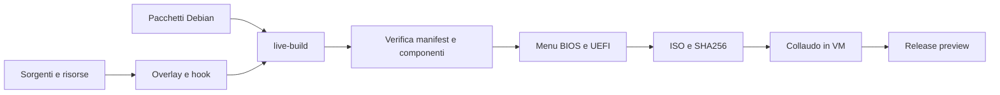

# Architettura

La scrivania corrente è Plasma nativo. Il prototipo web precedente è isolato in `archive/legacy-web-shell` e non è usato dalla build 2.

| Percorso | Responsabilità |
| --- | --- |
| `build/` | Assemblaggio live-build, boot BIOS/UEFI, verifica filesystem e finalizzazione ISO |
| `components/base` | Pacchetti di base, servizi e configurazione Calamares |
| `components/perf` | Impostazioni grafiche e strumenti VirtualBox |
| `components/theme` | Token, generatori e risorse grafiche |
| `components/desktop` | Layout Plasma, dock, menu e associazioni |
| `components/settings-store` | KCM C++/QML, configurazione condivisa e Discover |
| `components/apps` | Browser, estensione, native host e spazi |
| `components/terminal` | Terminale Python/PySide6, PTY ed esecutore |
| `components/assistant` | Pannello QML, strumenti locali e integrazione D-Bus |
| `components/onboarding` | Benvenuto, guida, testi e suggerimenti |
| `components/qa` | Verifiche host/VM, non installate come applicazioni |
| `tools/` | VM QEMU e distribuzione dei componenti per sviluppo |

Gli overlay sono applicati nell'ordine: base, perf, theme, desktop, settings-store, apps, terminal, assistant, onboarding, qa. Ogni componente può aggiungere pacchetti, file e hook. `/etc/vela/components.list` registra l'assemblaggio. La build deve fallire se un componente richiesto manca.

Il contratto della configurazione dell'assistente è in [AI_CONFIG.md](../components/settings-store/AI_CONFIG.md). L'esecutore e il modello sono servizi distinti: la presenza del pannello non implica che un modello sia installato o funzionante. Per modifiche ai file e comandi, mantenere anteprima, conferma e gestione degli errori; ogni nuovo flusso necessita di prove specifiche.
