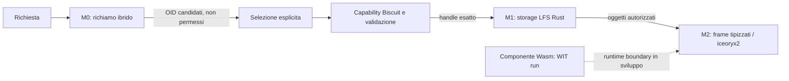

# Architettura corrente: M0–M2

VelaOS sta costruendo un sistema personale AI-native con autorità deterministica e dati locali. M0, M1 e M2 sono spike/prototipi separati: non sono ancora un servizio integrato né una distribuzione installabile. La precedente preview Debian/KDE è conservata in `components/`, `build/` e nei documenti desktop; non è l'implementazione dell'architettura corrente.

Il flusso rappresenta le responsabilità e il bridge sperimentale, non un prodotto end-to-end. Il sandbox Wasmtime non è ancora connesso al bus o a un planner. I risultati semantici sono candidati: non possono concedere accesso né scegliere byte senza policy e un handle esatto.

## Milestone

| Fase | Responsabilità | Stato verificato |
| --- | --- | --- |
| M0 | Embedding locale, BM25 e fusione RRF; restituisce OID candidati. | Gate sintetico chiuso: 186/200 recall@1 e p95 25,67 ms. Non è un benchmark indipendente su dati reali. |
| M1 | Canonicalizzazione BLAKE3, storage redb, cifratura a chunk, commit firmati, policy Biscuit e handle a scadenza. | Kernel e gate di 10.000 terminazioni di processo registrati come passati. Non prova power-loss, servizio distribuito o integrazione in produzione. |
| M2 | Autorità delle route, frame tipizzati e trasporto IPC; boundary Wasmtime per task. | Bridge iceoryx2 multi-processo provata localmente. Target di throughput, isolamento dei peer e nuovo build Wasmtime restano aperti. |

## Confini dei componenti

- **Recall M0:** Python è confinato allo spike di ricerca semantica. I risultati includono score/OID, non capability o byte. Il gate usa cinque card e 200 parafrasi sintetiche.
- **LFS M1:** `poc/m1/` contiene il kernel Rust. Gli OID identificano il plaintext canonico; lo storage conserva dati cifrati e un log append-only firmato. L'apertura restituisce attualmente un buffer interno, non uno stream zero-copy.
- **Neural Bus M2:** `poc/m2/` valida Biscuit e route prima del data plane iceoryx2. La misurazione 62.222 msg/s è ping/ack sequenziale da 4 KiB; lo staging dei byte LFS nel loan fa una copia. Il trasporto bulk con backpressure non è implementato.
- **Wasm boundary M2:** `poc/m2/src/sandbox.rs` carica un componente Wasmtime attraverso l'interfaccia WIT `run`. La configurazione limita la memoria privata a 16–64 MiB, imposta fuel e ammette al massimo due task concorrenti. Il linker è vuoto: nessuna importazione WASI o capacità host viene registrata. Il codice è presente, ma compile, test e integrazione non sono ancora verificati.

## Mappa del repository

| Percorso | Scopo |
| --- | --- |
| `poc/m0/` | Spike Python di hybrid recall e valutazione congelata. |
| `poc/m1/` | Kernel Rust LFS, test e report del gate crash. |
| `poc/m2/` | Neural Bus Rust, test IPC e boundary Wasmtime in sviluppo. |
| `docs/` | Gate, limiti, roadmap e procedure; alcune guide desktop sono storiche. |
| `components/`, `build/`, `tools/` | Implementazione e pipeline della precedente preview Debian/KDE. |
| `archive/` | Prototipo web ancora più vecchio, separato dalla preview desktop. |

Per dettagli e riproduzione dei gate, partire da [README](../README.md), [M0](../poc/m0/README.md), [M1](../poc/m1/README.md) e [M2](../poc/m2/README.md).
