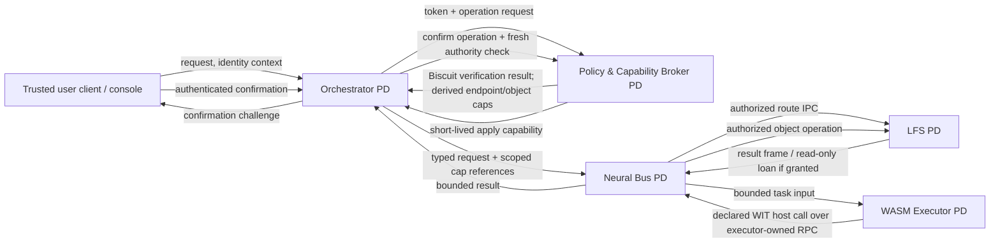

# Gate M5 — seL4 / QEMU Architecture Design

**Status:** Proposed architecture; not implemented or validated
**Scope:** Port the VelaOS control and data-plane prototype into isolated seL4 protection domains, initially booted and tested under QEMU.
**Predecessors:** M2 Neural Bus, M3 deterministic intent/router boundary, and M4 LFS/restore coordinator. Their current Rust/Linux prototypes are design inputs, not evidence that their services already run on seL4.

## 1. Executive summary

M5 replaces Linux process isolation as the primary service boundary with seL4 capability-based protection domains. It does not move policy into the kernel and it does not turn Biscuit tokens into kernel capabilities. A user-space **Policy and Capability Broker (PCB)** verifies each Biscuit token, evaluates application-level predicates, and—only after authorization—derives a narrowly scoped, short-lived set of native seL4 capabilities for the requested operation.

The first QEMU image should contain distinct domains for:

1. **LFS service** — owns persistent object storage, encryption/signature keys, and exact-object operations.
2. **Neural Bus** — owns typed IPC routing and bounded control/data transport; it does not authorize operations.
3. **WASM executor** — hosts Wasmtime and untrusted components, with no WASI and no ambient service capabilities.
4. **Orchestrator** — accepts user intent, coordinates the finite validated workflow, and cannot mint capabilities or directly access LFS storage.
5. **Policy and Capability Broker** — verifies Biscuit authority and is the sole dynamic minting/revocation authority for application capabilities.

Each service runs in its own address space with an explicit CSpace, VSpace, TCB, scheduling budget, and initial capability set. IPC is through endpoint capabilities. Shared frames are an optimization granted only to named peers and only for bounded, typed buffers; the default control path copies small messages. A Wasm component receives only declared WIT imports that are explicitly linked by the executor. It never receives a seL4 capability, Biscuit token, LFS key, or arbitrary endpoint handle.

QEMU is the first repeatable platform for boot, fault-injection, IPC, authority, and resource-bound tests. A passing QEMU gate is not a proof of physical-device DMA isolation, secure boot, GPU isolation, or production hardware suitability.

## 2. Goals, non-goals, and decisions

### 2.1 Goals

- Make the kernel-enforced protection-domain boundary explicit for LFS, bus, executor, orchestrator, and the authority broker.
- Preserve the application rule that model output is a proposal only; deterministic policy and trusted confirmation remain outside the model.
- Translate application-level authorization into least-authority, revocable seL4 capabilities without treating signed tokens as kernel objects.
- Boot the minimum service graph reproducibly in a pinned QEMU/seL4 configuration.
- Bound task memory, instruction fuel, wall-clock execution, IPC payload size, queue depth, and concurrency.
- Make failures fail closed: invalid or expired authority yields no usable operation capability.

### 2.2 Non-goals for the initial M5 gate

- Declaring M4's pending hardware, full-system memory, production ingress, or end-to-end tests complete.
- Porting a general-purpose Linux desktop or allowing Linux services to run as trusted VelaOS domains.
- Giving the Wasm executor direct access to devices, persistent storage, network stacks, host filesystems, or WASI.
- Granting a GPU or passing through host devices to the SLM in the first QEMU gate.
- Claiming side-channel freedom, physical secure boot, DMA isolation, or production key custody from a QEMU demonstration.
- Running an untrusted dynamic module loader with authority to create arbitrary CNodes, TCBs, or device capabilities.

### 2.3 Architectural decisions

| Decision | Rationale |
| --- | --- |
| Use a separate PCB domain as sole dynamic capability broker | Prevents the orchestrator, bus, LFS, and guest task from minting authority for themselves. |
| Keep Biscuit verification and application policy in user space | Biscuit predicates, expiry, revocation, and object semantics are application policy, not kernel responsibilities. |
| Let seL4 enforce object possession and IPC reachability | Kernel capabilities provide unforgeable access to specific kernel objects; the kernel does not interpret Biscuit claims. |
| Create a new bounded Wasmtime `Store` per invocation | Avoids accidental state/capability reuse between tasks and makes per-task fuel and memory limits explicit. |
| No WASI; exact WIT imports only | Prevents ambient filesystem, socket, process, clock, and environment access. |
| Static boot authority plus narrow dynamic delegation | Keeps bootstrap construction authority out of ordinary services while allowing authorized operations to receive temporary endpoint/object authority. |
| QEMU before hardware | Enables reproducible boot and fault tests; hardware qualification remains a later, separate evidence requirement. |

## 3. Target architecture and protection domains



The diagram shows logical roles, not an assumption that every call must transit a single broker process. Each caller talks only to endpoints present in its CSpace. The PCB authorizes a route and gives the designated caller only the capabilities required for that route. The bus can transport an authorized message but cannot expand its authority or infer permission from message contents.

### 3.1 Domain inventory

| Protection domain | Owns | Initial authority | Must not own |
| --- | --- | --- | --- |
| **Bootstrap / root task** | Initial seL4 objects and service construction; disposable after boot where practical | Boot-time untyped memory, initial CNode authority, image/configuration objects, narrowly delegated construction caps | User-facing request processing or normal LFS operations |
| **Policy and Capability Broker (PCB)** | Biscuit root public keys, policy epochs, revocation state, lease ledger, narrowly scoped CNode mint/revoke authority | Read-only trust configuration; PCB's private IPC endpoints; authority to derive caps only in designated service CNodes | LFS plaintext or arbitrary object bytes; model-generated plans; unrestricted device or root authority |
| **Orchestrator** | Finite workflow state, request correlation, trusted confirmation state machine | User ingress endpoint; PCB authorization endpoint; bus client endpoint; bounded timer/notification capability | CNode mint authority; LFS database/key access; raw device capabilities; arbitrary bus routes |
| **Neural Bus** | Route table, bounded queues, typed frame validation, transport sequencing | Endpoints for admitted peers; optional bounded shared-frame mappings; timer/notification for queue deadlines | Biscuit signing roots; policy mint authority; LFS encryption keys; permission to create arbitrary endpoints or map arbitrary frames |
| **LFS service** | Encrypted object store, journal, integrity metadata, cryptographic keys, provider/supervisor state | Storage backend endpoint/device capability delegated by trusted bootstrap; PCB authorization endpoint; explicit object-operation endpoints | General model execution; arbitrary network access; capability minting; caller-selected storage paths |
| **WASM executor** | Wasmtime engine, validated component cache, per-task stores/limits, task scheduler | Bus task-submission endpoint; PCB task authorization endpoint; executor-owned timer; only exact host-call endpoint(s) required for configured WIT imports | WASI, ambient filesystem/network, LFS keys, general LFS endpoint, root CSpace, arbitrary endpoint or device capabilities |
| **Wasm guest instance** | Guest linear memory and task-local state inside executor PD | No kernel capabilities. Receives only input values and opaque, task-scoped application handles | seL4 CSpace entries, host pointers, native file descriptors, token bytes, arbitrary host calls |
| **Device / block driver (as needed)** | Specific emulated storage interface and bounded request queues | Only the device MMIO/IRQ or virtio queue capabilities required for that device | LFS keys, policy roots, arbitrary user endpoints, general DMA authority |

The device driver is a separate PD when the selected seL4 platform and device model permit user-level driver isolation. If a QEMU platform requires a privileged boot component or kernel-mediated device path, that exception must be documented as trusted computing base (TCB) and kept separate from application services.

### 3.2 Protection-domain construction

For each service, the initial system builder creates or provisions:

- a dedicated TCB with an explicit priority and scheduling context/budget;
- a VSpace with only its executable, read-only configuration, stack, and bounded heap mappings;
- a CSpace with a small, documented set of endpoint, notification, frame, reply, and service-specific capabilities;
- a fault endpoint terminating at a supervisor that may restart the service but cannot silently restore revoked application authority;
- a logging/diagnostic path with bounded messages and no secret-bearing payloads.

Static service topology should be generated from a reviewed capability manifest and loaded by the boot mechanism selected for the pinned seL4 release (for example, a capDL-described initial system). Runtime application delegation is separate: the PCB may derive only capability types and destinations explicitly allowed by that manifest. No ordinary PD receives the root CNode capability or untyped memory from which it could construct an unconstrained CSpace.

An endpoint capability is authority to invoke that endpoint, not proof that an application-level action is authorized. Service handlers still validate message type, caller identity/badge, operation state, bounds, and any lease identifier. A message naming an object is not authority to read it.

### 3.3 Shared memory and bulk data

Use copied IPC for control messages and small payloads. For bulk transfers, the PCB authorizes a specific producer/consumer pair and the bus coordinates a fixed-size pool of shared frames:

1. The allocator creates or selects a bounded frame pool and grants mappings only to the bus and the exact authorized service(s).
2. The sender receives write access only to an assigned slot; the receiver receives read-only access where the seL4 mapping model supports that separation.
3. A typed descriptor binds the slot, length, sequence, schema, operation/lease identifier, and content digest.
4. The receiver validates the descriptor and digest before consuming data. The bus enforces credits, cancellation, and queue limits.
5. Slot ownership is returned before reuse. Capabilities to the pool are revoked or discarded when the operation ends.

The initial M5 implementation should prefer copies over clever shared-memory sharing until the object/authority lifecycle is tested. Shared frames are not confidential merely because they are capability protected: every mapper, stale mapping, DMA-capable device, and cache-coherency path is part of the threat analysis.

## 4. Biscuit authorization to native seL4 capabilities

### 4.1 No direct token-to-capability conversion

A Biscuit is a signed application-level authorization token. A seL4 capability is an unforgeable kernel reference to a kernel object. They are different mechanisms with different semantics:

- Biscuit verification establishes that a trusted issuer signed claims and that the claims satisfy the configured authorizer policy at a particular time and policy epoch.
- Possession of a seL4 endpoint/frame/notification capability establishes that the holder may invoke or access that specific kernel object.
- The kernel does not parse Biscuit bytes, understand OIDs, enforce token expiry, or infer whether a user confirmed a restore.
- Copying the Biscuit into a CSpace does not create a seL4 capability. Converting a claim string directly to an endpoint slot is forbidden.

The PCB bridges the models. It verifies the token and the complete operation context, then derives a short-lived native capability grant for a specific request. Capability possession authorizes reachability to a narrow service entry point; service-side policy continues to validate the request-specific lease and operation semantics.

### 4.2 Authorization and derivation flow

1. **Ingress binding:** The trusted ingress authenticates the caller and binds a request ID, caller principal, operation, target OID/opaque handle, policy epoch, and confirmation state. Values supplied by a planner or guest are untrusted.
2. **Token verification:** The PCB verifies the Biscuit signature chain against configured public roots, checks expiry and revocation state, applies bounded authorizer limits, and evaluates the required predicates for caller, operation, schema, object scope, and domain.
3. **State binding:** For state-changing operations, the PCB checks the durable coordinator state, exact target OID, previous-state binding, one-time confirmation ticket, deadline, and current policy/registry epochs. A model output or cached proposal cannot satisfy these checks.
4. **Least-authority decision:** The PCB selects a predeclared grant profile such as `lfs.read.oid`, `restore.prepare`, or `restore.apply.confirmed`. Profiles specify endpoint, rights, recipient CNode, lifetime, payload bound, and whether an operation lease is required. They never accept an arbitrary endpoint address or CPtr from the caller.
5. **Capability derivation:** The PCB copies/mints a capability derived from a protected template capability into a designated recipient CNode slot, with rights no broader than the template and grant profile. Where badges are used, the badge identifies the grant/route for receiver-side dispatch; it is not a substitute for authorization or message validation. The exact seL4 invocation and rights must be implemented against the pinned kernel API and reviewed.
6. **Lease issuance:** Alongside the derived capability, the PCB issues an unpredictable, bounded lease ID and operation metadata to the recipient and target service over authenticated IPC. The lease contains no signing key and cannot be used to mint another capability.
7. **Service-side enforcement:** The receiving service validates the caller/badge, lease ID, operation, exact OID/handle, schema, bounds, sequence, expiry, and current operation state. A capability to a generic service endpoint is insufficient to bypass this validation.
8. **Revocation and cleanup:** On completion, cancellation, expiry, caller revocation, epoch change, or service restart, the PCB revokes descendants of the grant's protected derivation root using the supported CNode revoke operation, where possible, and tells services to invalidate the lease. It also removes outstanding shared-frame mappings/slots and rejects stale lease IDs.

An expiry timestamp is not natively enforced by seL4. Therefore, every service must check the lease at use time, and revocation must not depend only on deleting a CSpace slot in the caller. The PCB retains a protected derivation root per grant or per bounded grant generation; services consult the lease state for sensitive or multi-step operations. Unresponsive or compromised recipients are handled by revoking derivations and, if necessary, destroying/recreating the recipient TCB/CSpace. The exact revocation strategy is a design decision to validate with the pinned seL4 kernel and should be covered by capability-lineage tests.

### 4.3 Grant mapping

| Biscuit/application decision | Native seL4 authority issued | Additional service-side checks |
| --- | --- | --- |
| Read exact, authorized OID | Call capability to a read-only LFS operation endpoint, scoped by lease and opaque handle; optionally read-only frame mapping for one result slot | Exact OID, caller, schema, maximum bytes, lease expiry, digest |
| Recall candidates | Call capability to a bounded recall/query endpoint; result contains candidate OIDs only | Query length, result count, policy filtering before any open |
| Prepare restore | Call capability to the restore-prepare endpoint; no apply capability | Exact target and previous-state binding, caller, durable journal state |
| Human-confirmed apply | Separate one-shot capability to the apply endpoint, minted only after trusted-client confirmation and fresh policy check | One-time ticket, matching request/caller/OID, deadline, compare-and-apply state |
| Keep or rollback management | Narrow operation capability to the supervisor endpoint for the exact transaction | Fresh write authority for KEEP; dedicated exact-object recovery grant for rollback |
| Wasm task object read | No direct LFS kernel capability in the guest; executor gets a narrowly scoped host-call route if approved | Executor validates guest opaque handle against task lease; LFS independently validates exact OID and rights |

Grants are not transitive by default. A bus capability does not imply an LFS capability; the broker provisions both ends of an authorized route with only the endpoint/mapping authority each needs. In particular, a capability passed to the Orchestrator must never be a CNode-management capability or a template from which broader endpoint authority can be minted.

### 4.4 Revocation, epochs, and restart

- Biscuit expiry and revocation are checked at each authorization decision; a cached plan is never a cached grant.
- Each grant binds the policy epoch, registry/schema epoch, authenticated principal, request ID, operation, and exact object scope.
- A policy/registry epoch change invalidates relevant active leases and requires fresh authorization.
- One-shot apply authority is consumed durably before the side effect. Restart must not recreate it from an untrusted client retry.
- Service restart begins with a fresh CSpace and no restored dynamic grants. The PCB reconciles leases with the durable M4 operation journal before issuing new authority.
- If the PCB is unavailable, new authority is denied. Recovery actions use only an explicitly provisioned, exact-object recovery profile; they do not inherit a user's unrestricted expired token.
- Audit records include grant identifiers, policy decision codes, target OIDs or privacy-preserving references, epochs, and lifecycle outcomes. Do not log raw Biscuit tokens, key material, plaintext objects, or confirmation secrets.

## 5. IPC and service interfaces

The following are logical interfaces; their wire encoding, CPtr handling, badges, and error ABI are to be fixed during implementation. CPtrs are local names within one CSpace and must never be treated as portable global object identifiers.

### 5.1 PCB authorization interface

```text
authorize(request: AuthorizationRequest)
    -> Result<GrantDescriptor, DenyCode>

AuthorizationRequest {
    request_id: RequestId,          // unpredictable or replay-resistant
    principal: AuthenticatedId,     // supplied by trusted ingress
    biscuit: BoundedTokenBytes,     // bounded, never forwarded to guest
    operation: OperationKind,      // closed enum; no arbitrary method string
    target: Option<OpaqueHandle>,   // server-issued handle, not a path
    schema_epoch: SchemaEpoch,
    policy_epoch: PolicyEpoch,
    confirmation: Option<OneShotTicket>,
}

GrantDescriptor {
    grant_id: GrantId,
    endpoint_slot: LocalCapabilitySlot,
    lease_id: LeaseId,
    rights: ClosedRightsSet,
    max_payload: u32,
    expires_at: MonotonicDeadline,
    policy_epoch: PolicyEpoch,
}
```

The response is delivered over a protected IPC channel. `endpoint_slot` is meaningful only to the named receiving CSpace. The request interface cannot select a CSpace, endpoint object, cap rights, lifetime, or raw slot.

### 5.2 Neural Bus message envelope

```text
BusEnvelope {
    version: u16,
    route: ClosedRouteId,
    request_id: RequestId,
    grant_id: GrantId,
    lease_id: LeaseId,
    sequence: u64,
    schema: ClosedSchemaId,
    payload_len: u32,
    payload: BoundedPayloadOrFrameDescriptor,
}
```

The bus rejects unknown versions/routes/schemas, oversized payloads, invalid sequence numbers, stale leases, queue exhaustion, and frames outside the granted pool. It does not authorize an OID because that OID appears in an envelope.

### 5.3 Wasm component interface

```wit
package vela:task@1.0.0;

interface object-access {
    read: func(handle: list<u8>, maximum: u32) -> result<list<u8>, access-error>;
    enum access-error {
        denied,
        expired,
        too-large,
        unavailable,
    }
}

world task {
    import object-access;
    export run: func(input: string) -> result<string, string>;
}
```

This example is a proposed task profile, not an instruction to grant every task object access. The executor links only imports allowed by the component's signed manifest and the current task grant. The component receives a server-issued opaque handle only when the task is authorized. The guest cannot select a principal, extend rights, confirm an action, access a path, or call arbitrary methods. Side-effecting operations stay in trusted services and require their own authorization/confirmation path.

## 6. WASM execution model

Wasmtime remains user-space code inside the WASM Executor protection domain. The seL4 boundary isolates the executor process from other services; Wasmtime's component/runtime checks isolate the guest from the executor's memory and imported functions. Neither boundary replaces the other.

### 6.1 Per-task lifecycle

1. The Orchestrator submits a bounded task request over the bus. The PCB authorizes task class, component hash/version, resource profile, and any allowed host-call profile.
2. The executor validates the component format, expected world/interface, signature/hash, import allowlist, and declared limits before instantiation. Validation and compilation have their own byte, time, and memory budgets.
3. The executor creates a fresh `Store` and task state for the invocation, installs a memory/resource limiter, sets a fuel budget, sets an epoch deadline, and creates only the explicitly allowed linker imports. There is no default linker fallback and no WASI context.
4. The guest executes synchronously under a bounded scheduler slot. Imported host calls use bounded IPC requests and enforce their own payload/deadline/lease checks. No imported call blocks indefinitely waiting for a bus or device.
5. On return, trap, fuel exhaustion, epoch interruption, cancellation, or deadline, the executor drops the Store and per-task state, invalidates host-call leases, releases shared-frame credits, and emits a bounded result/error.
6. A watchdog outside the guest execution path advances the Wasmtime engine epoch. If the guest does not reach a safepoint before its epoch deadline, Wasmtime interrupts it. The executor supervisor treats interruption as task failure, not partial success.

### 6.2 Resource limits

The M2 prototype currently has a 16–64 MiB Store memory limit, 10,000,000 fuel units per task, a 1 MiB input/output limit, and at most two concurrent tasks. M5 should start with these as candidate defaults but must requalify them in the seL4 image; they are not yet M5 guarantees.

Each task profile must specify and test:

- maximum component bytes and validation/compilation work;
- maximum linear memory, instances, tables, memories, and stack/recursion behavior;
- fuel budget and epoch deadline (instruction bound and elapsed-time bound are separate controls);
- maximum input/output bytes and host-call count/bytes;
- maximum concurrent tasks and per-task scheduling budget;
- maximum shared-memory frames and queue credits;
- cancellation, timeout, trap, and service-restart behavior.

Fuel provides deterministic accounting for Wasm execution, not a wall-clock guarantee. Epoch interruption depends on a functioning trusted incrementer and Wasmtime reaching interruptible execution points. Host functions, compilation, blocking IPC, page faults, and native runtime code need independent limits and supervision. For this reason, the guest must not receive WASI and host functions must be short, bounded, nonblocking or deadline-aware, and separately audited.

### 6.3 Executor authority

The executor CSpace contains no general LFS endpoint or object-store key. If a task needs an object read, the executor makes an authorized request through its narrow host-call route; the executor validates the per-task lease, and LFS independently enforces the exact object grant. The guest sees a bounded copy or explicitly scoped read-only frame, never a CPtr or pointer into host memory. The guest cannot mint, duplicate, transfer, or retain a native capability.

## 7. QEMU boot and runtime sequence

### 7.1 Build and artifact pinning

- Pin the seL4 source revision, toolchain, platform configuration, capDL/boot artifacts, Rust toolchain/target, Wasmtime version, component ABI, and third-party dependency lockfiles.
- Build a minimal QEMU image with only the kernel, boot/system-description artifacts, trusted bootstrap configuration, and required service images.
- Record cryptographic hashes and reproducible build inputs for every artifact. Signed boot/update and protection of signing keys are production requirements; QEMU artifact hashes alone do not establish a hardware root of trust.
- Choose one explicit QEMU machine/platform configuration supported by the pinned seL4 release. Do not assume Linux device drivers or Linux syscall compatibility.

### 7.2 Boot order

1. QEMU loads the pinned seL4 image and the selected system-description/boot payload.
2. seL4 initializes the kernel and hands initial authority to the trusted root task/loader.
3. The root task validates the boot manifest, constructs service TCBs, CNodes, VSpaces, endpoints, notifications, scheduling contexts, and bounded frame pools from the declared memory budget.
4. The root task installs the reviewed static capability graph and starts services in dependency order: device/storage driver as required; PCB trust/policy state; LFS; Neural Bus; WASM executor; Orchestrator; trusted console/test client.
5. Each service reports a bounded readiness record over its designated endpoint. The root task verifies expected service identity/version and closes bootstrap-only channels.
6. Dynamic application grants begin only after all mandatory services are healthy and the PCB's trust configuration and revocation epoch are loaded.
7. After startup, the root task retains only the supervision and recovery authority required by policy. It does not service ordinary application operations.

Startup failure is fail-closed: the Orchestrator does not accept requests if the PCB or LFS is unavailable; the executor does not run tasks if its limits or WIT allowlist cannot be established; the bus does not route unknown service identities. Restarted services receive fresh CSpaces and must re-register before any grants are reissued.

### 7.3 QEMU storage and platform limits

The first QEMU gate should use a deterministic emulated storage path and synthetic/fault-injected data. The LFS service owns object formats, encryption, journal, and authorization; a block/device driver exposes only bounded block operations. Do not mount the host filesystem inside a trusted service or pass host paths to guest tasks. Any use of host-backed files is test infrastructure, not the product authority model.

QEMU results validate the configured virtual machine and code paths. They do not prove real-device interrupt behavior, DMA isolation, GPU placement, power-loss durability, physical secure boot, timing determinism, or the final whole-OS memory budget.

## 8. Failure handling and recovery

| Failure | Required behavior |
| --- | --- |
| Invalid, expired, revoked, or wrong-scope Biscuit | PCB denies; no dynamic cap is derived; no service side effect occurs. |
| Stale lease or policy epoch | Service rejects request; PCB revokes/reissues only after fresh evaluation. |
| Guest fuel exhaustion or epoch timeout | Trap/interruption becomes a failed task; discard Store and task grants; no partial success is reported. |
| Wasm import not in manifest | Reject component before execution; linker has no ambient/default imports. |
| Bus queue/frame exhaustion | Apply bounded backpressure or reject/cancel; do not allocate without limit or block unrelated routes. |
| LFS/driver failure | Return explicit service error; preserve journal/recovery state; do not convert failure into success-shaped output. |
| PCB crash/restart | Deny new grants; revoke by destroying/recreating affected recipient CSpaces as necessary; reconcile lease and durable operation state before resuming. |
| Orchestrator crash during restore | M4 durable supervisor/journal determines rollback or recovery; confirmation and apply capabilities are not reconstructed from an untrusted retry. |
| Service restart with old shared mappings | Do not restore dynamic mappings; validate generation and reconstruct from the static manifest. |

## 9. Threat model and residual risk

### 9.1 In scope

- Malicious or malformed Wasm components attempting to escape linear memory, exhaust resources, import ambient authority, forge task identity, replay handles, or retain authority after task completion.
- Compromised Orchestrator attempting to broaden authority, bypass confirmation, or access LFS bytes outside authorized operations.
- Malicious/malformed bus messages, stale/replayed leases, invalid frame descriptors, route confusion, queue exhaustion, and unauthorized endpoint invocation.
- Compromised non-root services attempting to access another service's memory or invoke endpoints absent from their CSpace.
- Expired/revoked Biscuit tokens, policy epoch changes, stale grants, and service restart during an operation.

### 9.2 Trusted computing base

The TCB includes the pinned seL4 kernel and configuration, boot/root task or capDL loader, PCB and its token-verification/policy code, cryptographic libraries and protected trust configuration, service-specific validation code, Wasmtime and native dependencies, compiler/toolchain/artifact provenance, and the QEMU host for QEMU-only results. The LFS cryptographic implementation and trusted confirmation ingress are also security-critical.

### 9.3 Out of scope or requiring later evidence

- QEMU host compromise, hypervisor escape, host kernel/firmware attacks, and physical attacks.
- Hardware cache/timing side channels, speculative execution behavior, and constant-time guarantees not separately audited.
- DMA-capable devices or GPU passthrough without a validated IOMMU and device-isolation design.
- Secure/verified boot and signing-key custody on target hardware.
- Availability against host resource starvation or malicious trusted services.
- Whole-system <1.5 GB RAM and active SLM memory/latency qualification; these require integrated measurements and may reopen M4.

seL4 reduces ambient authority but does not make buggy services correct. The PCB, service message validation, grant lifecycle, build provenance, and recovery design remain essential.

## 10. M5 implementation and acceptance gates

M5 is complete only when the following evidence is recorded for the pinned source/configuration. The test image is not a release image.

### Gate A — reproducible boot

- Build and boot the same pinned seL4/QEMU image from a documented clean environment.
- The scaffold in [`poc/m5_sel4/`](../poc/m5_sel4/) pins Microkit SDK 2.3.0, `rust-sel4` v5.0.0, and that release's Rust toolchain. Its five-domain image has built and booted under QEMU; this verifies startup only, not service readiness, isolation attacks, or hardware behavior.

### Gate B — initial static domain separation

- The scaffold declares separate `pcb`, `orchestrator`, `bus`, `lfs`, and `executor` protection domains, each mapped to its own Rust ELF. Microkit supplies each domain with a distinct CSpace and VSpace.
- The five-domain image builds and boots in QEMU. This is an initial static-separation milestone, not completion of the full Gate B acceptance criteria below.
- Capability manifests, constrained initial authority, negative reachability tests, and crash/restart isolation tests remain required before Gate B can be considered fully closed.
- Record source revisions, build commands, artifact hashes, QEMU machine/configuration, boot log, and service versions.
- Reboot repeatedly and verify deterministic startup order and explicit readiness/failure behavior.

### Gate B — domain isolation and capability inventory

- Produce a machine-readable or reviewable CSpace/capability manifest for each PD.
- Demonstrate that no service has root CNode/untyped authority except the minimal bootstrap/supervisor authority explicitly documented.
- Negative tests: Orchestrator cannot open LFS storage directly; bus cannot authorize or mint; executor/guest cannot import WASI or reach LFS directly; one service cannot invoke another service's ungranted endpoint.
- Verify that CSpace separation and VSpace isolation survive service crash/restart.

### Gate C — Biscuit-to-capability broker

- The current Microkit image is intentionally static: channels provide protected calls and notifications but do not transfer capabilities between CSpaces. Dynamic grants therefore require a privileged bootstrap/root-task design, not only PCB application code.
- A standalone root-task proof under `poc/m5_sel4/pcb_root/` boots as a separate seL4 image in QEMU. It creates a live child with its own CSpace and VSpace, mints a badged send-only endpoint capability into the child CSpace, receives the child’s IPC and verifies its badge, replies, then deletes the grant and suspends the child. This confirms the core dynamic derivation and transfer path; it does not integrate Biscuit verification, configurable policy profiles, timed leases, or deny/revocation tests, so Gate C remains open.
- Test valid, invalid-signature, expired, revoked, wrong-principal, wrong-OID, wrong-operation, stale-epoch, replayed-confirmation, and attenuated-token cases.
- Assert denied requests create no endpoint/frame grant and cause no persistent side effect.
- Verify exact rights, recipient CSpace, lease duration, operation binding, and post-completion revocation for each grant profile.
- Demonstrate that capability possession alone cannot bypass LFS lease/object checks and that an application token alone is not a seL4 capability.

### Gate D — bounded Wasm execution

- The executor protection domain now embeds a fixed Wasm probe and runs it with Wasmi 2.0.0 built without `std`, WASI, or host imports. The QEMU run verifies that a fuel-metered infinite loop traps at a 64-unit probe budget, that the production Store is configured with a 10-million-unit budget, that memory growth beyond 64 KiB is denied, and that Wasmi's value stack and recursion depth are capped. This is an executor-boundary proof, not yet a task-ingress API or complete Gate D closure.
- Run allowed and disallowed components; reject undeclared imports and all WASI imports.
- Demonstrate memory limit, fuel exhaustion, epoch timeout, input/output bound, concurrency cap, cancellation, and fresh-Store cleanup.
- Verify a task cannot retain or transfer a native capability, access a host pointer, or use a stale object handle after completion/revocation.
- Test that blocked/failed host calls obey deadlines and cannot hold unbounded bus credits or executor slots.

### Gate E — bus/LFS/restore integration

- Run an end-to-end bounded flow from authorized ingress through policy, bus, exact LFS read, and task result; separately verify confirmation-required restore and rollback/recovery.
- Test replay, malformed frames, wrong caller/route/schema, slow consumer, service crash, PCB restart, LFS failure, queue exhaustion, and shared-frame cleanup.
- Preserve M4's durable operation and rollback invariants; M5 isolation does not replace them.

### Gate F — resource accounting and limits

- Record per-domain and integrated memory, scheduling budgets, concurrency, queue/frame bounds, and task completion distributions under the QEMU workload.
- Measure idle and active whole-system memory, including kernel objects, mappings, allocator slack, Wasmtime/JIT, LFS caches, and driver buffers.
- Re-run M4 hardware-dependent SLM memory/latency qualification separately. Do not infer those results from a CPU-only QEMU task benchmark.

### Gate G — security review and residuals

- Review boot authority, PCB mint/revoke path, service CSpaces, IPC schemas, task imports, fault handling, update/restart flow, and debug surfaces.
- Publish remaining assumptions and unresolved risks. A clean boot or passing functional suite alone is not a security qualification.

## 11. Open design decisions before implementation

1. Pin the seL4 release, supported QEMU machine/platform, root-task strategy, and static capability-description format.
2. Select the target Rust environment and establish which services can be built `no_std` versus requiring a documented user-level runtime.
3. Choose and validate Biscuit verifier support, root-key provisioning, trusted time source, revocation distribution, and restart semantics in the PCB.
4. Specify endpoint badges, CSpace slot allocation, capability derivation roots, revoke granularity, and CNode lifecycle against the pinned kernel.
5. Decide whether bus-to-LFS bulk transfer starts with copies or a fixed shared-frame pool; prove slot lifecycle and revocation before optimizing.
6. Wasmi 2.0.0 is pinned as the current `no_std` runtime candidate; specify the fuel profile, optional wall-clock deadline, and component signature/manifest format before exposing task ingress.
7. Define the trusted confirmation client's identity and IPC/device boundary; console input in QEMU is a test client, not a production authentication design.
8. Define storage-driver isolation and durability assumptions. QEMU power loss is not equivalent to physical power-loss testing.
9. Decide whether an inference service is in M5 scope. The initial design keeps SLM/GPU execution out of the privileged path and does not assume GPU passthrough.

## 12. Summary

M5's central security rule is **policy authorizes; the PCB delegates; seL4 enforces possession; services validate semantics**. Biscuit tokens remain verifiable application credentials, never kernel capabilities. The Wasm guest remains capability-free and receives only bounded data and explicitly linked, task-scoped imports. QEMU provides a reproducible environment to implement and test these boundaries, while hardware, memory, latency, secure boot, and DMA claims remain separate evidence obligations.
