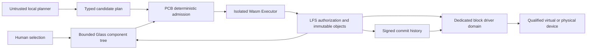

# Native convergence audit and delivery gates

Date: 2026-10-12. Audited baseline: `f8da280301d9c9864f285bc1c050924ef8df9a81`.
This report is based on current source inspection. Prior boot and performance
reports remain historical evidence unless explicitly re-executed below.

## Decision

The final kernel direction is seL4/Microkit. The current x86 Glass image is a
separate custom C/assembly kernel with a small Rust surface model, not a seL4
desktop. Keep it as a visual/input reference while porting the UI into a bounded
display/input client domain. Do not add a second security kernel underneath it,
pretend that the two kernels are combined, or make Linux a product dependency.

Initial integration target: existing QEMU `virt` AArch64 Microkit configuration.
The x86 VirtualBox preview remains separately runnable. A real computer is not
qualified yet; choose one only after confirming SDK, boot, display, input and
device-driver support. No current Windows replacement claim is justified.

## Original invariants

Read from Section 1 of the supplied 15-page *VelaOS — LFS + Neural Bus PoC
Specification*, dated 2026-10-10. The original file is not republished here.

| Invariant | Implementation obligation |
| --- | --- |
| I1 Content identity | Immutable OID = BLAKE3 of canonical plaintext; meaning is only an index. |
| I2 Deterministic authority | Model proposes typed plans; policy decides. |
| I3 Two planes | Resolve once on control plane; typed bytes move without the model. |
| I4 Recall semantics | Ranked search gives candidates; authorized handle gives exact bytes. |
| I5 Reversible changes | Signed append-only history, explicit confirmation and rollback policy. |
| I6 Model epochs | Every embedding records its model; changes require migration. |

The original PoC used host processes and simulated hardware; its kernel was
explicitly out of scope. This roadmap extends the scope without treating those
host adapters as native implementations. Its statement about translating
Biscuit into kernel capabilities requires a deterministic authority boundary:
token possession does not itself create a kernel capability.

## As-built component inventory

| Component | Source | Current boundary |
| --- | --- | --- |
| Native Glass preview | `os/x86_64/src/kernel.c`, `glass.rs`, `glass_ui.inc` | Photographic framebuffer UI, PS/2 input, finite keyword intents, RAM notes. No production assistant, audio, network or durable storage. |
| seL4 PCB/Executor | `poc/m5_executor/app` | Shared-page protected calls, signed admission and bounded Wasmi. PCB exercises build-time fixtures, not live Glass requests. |
| Guest LFS writer | `app/src/bin/lfs.rs` | Signed receipt domain, eight-entry in-memory ledger; not block persistence. |
| Guest TTL | `app/src/guest_clock.rs` | Arm counter-based relative deadlines exist; older platform reports saying no clock are stale. No cross-boot RTC/TPM trust established. |
| Host policy | `poc/m5_executor/policy` | Biscuit verification and durable receipt ledger use `std`; not linked into the guest. |
| Host M1/M2/M3/M4 | `poc/m1` through `poc/m4` | Storage, bus, model and supervisor prototypes; process isolation is not native Microkit isolation. |
| Host Glass | `poc/product/glass` | Loopback HTTP demo, separate from native framebuffer Glass. |
| Recall | `poc/m0`, `poc/product/m0-recall` | Host embedding/index pipeline, not guest semantic search. |
| New block storage primitive | `poc/storage-core` | `no_std` implementation tested on host; cross-target compile. No guest adapter yet. |

No inference benchmark, old microbenchmark or configured VM capacity establishes
total native OS RAM. No new boot result is claimed for this storage-only change.

## Trust and dependency map

The graph is the target, not a claim of present integration. Model has no device
endpoint, signing key or byte-transfer role. Only preconfigured kernel authority
allows domains to communicate. Every byte interface needs schema/version,
length, request identity, ownership, acknowledgement and bounded flow control.

## Hardware matrix

| Target | Available evidence | Missing before qualification |
| --- | --- | --- |
| QEMU AArch64 `virt` | Existing Microkit boot/E2E reports and pinned build configuration | Block driver, durable objects, live UI input/display, network/audio, fault recovery. |
| VirtualBox x86 BIOS | Existing native Glass boot and lifecycle CI | seL4 convergence, persistent LFS, device services, assistant. |
| Physical machine | None qualified | Pick exact device and verify SDK/driver/firmware/licensing support before any installation. |
| Phones | No native boot qualification | Separate platform effort; no compatibility promise. |

## Sequential gates

| Gate | Entry / delivery | Exit evidence |
| --- | --- | --- |
| N0 Storage substrate | Dedicated extent and flush contract | Crash-cut recovery, error reconciliation, host process reopen and freestanding compile. Current component only. |
| N1 Guest block domain | N0 plus a qualified virtual controller | QEMU writes bytes, cold guest restart reads identical bytes; induced I/O failure and domain fault handled. |
| N2 Native LFS | N1 plus BLAKE3 immutable blobs and signed log | Object OID and signature verified, interrupted publication recovered, durable request/epoch reconciliation. |
| N3 Native note vertical | N2 plus display/input and live typed admission | Human types note, confirms, obtains receipt, reboots, opens exact object; expired/replayed/revoked requests denied. |
| N4 Connected workstation | N3 plus network, audio and browser feasibility | Real HTTPS browsing, transfer, sound and document backup; resources measured. |
| N5 Local assistant | N4 plus native inference feasibility | Offline structured intents, injection tests, manual fallback and full RAM/VRAM accounting. |
| N6 Secondary-PC release | Qualified physical hardware and update/recovery mechanisms | Full daily-use flow on target, signed update/rollback, extended fault tests. |
| N7 Main-PC eligibility | User's actual required software inventory | Required workflows, compatibility and recovery accepted on exact hardware. |

Modern browser, inference runtime, Wi-Fi firmware and GPU support require porting
and licensing feasibility work; they are not automatic Wasm tasks. No release
date is invented. Native Biscuit policy verification remains a porting blocker:
the current dependency uses `std`. Define and validate a native policy strategy
before treating build-time host admission as interactive guest authorization.

## Evidence from this change

New Rust storage tests verify recovery, bounds, flush-error poisoning and separate
writer/reader processes on a real test file. CRC protects accidental corruption,
not authenticity; the storage slot identity is not an OID. See
[`poc/storage-core/README.md`](../poc/storage-core/README.md) for commands and limits.
The complete Glass → PCB → Executor → persistent LFS vertical remains **open**.
