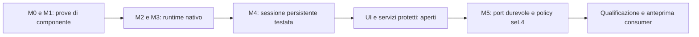

# Roadmap pubblica — runtime Neural e port seL4

La roadmap segue prove riproducibili, senza date promesse. La chiusura di un
componente su un fixture non certifica un sistema operativo consumer.

| Fase | Stato | Prova e limite |
| --- | --- | --- |
| M0 — richiamo ibrido | Gate sintetico chiuso | E5 locale, LanceDB Vector/BM25 e RRF; 186/200 parafrasi. Il collegamento nativo fino a KEEP è ora provato con embedding reali; qualità sui dati personali ancora da qualificare. |
| M1 — LFS | Gate storage registrato chiuso | Oggetti cifrati, OID, commit firmati e Biscuit; 10.000 terminazioni nel gate storico. Power-loss, anchor anti-rollback e servizio di produzione restano aperti. |
| M2 — Neural Bus e Wasm | Componenti implementati e testati | Lane fast/bulk, crediti, capability e Wasmtime senza WASI. Benchmark dual-lane registrati; bulk LFS durevole, identità/isolamento di produzione e port seL4 non completi. |
| M3 — control plane | Router locale implementato | Cinque intent finiti, policy Rust e cache con nuova autorizzazione. Modello non concede authority. Qualificazione ripetuta, ingresso persistente e RAM dell'intero OS restano aperti. |
| M4 — conferma e recovery | Milestone implementata, qualificazione aperta | Provider persistente M1, supervisor, rollback esatto e sessione nativa; 12 test locali con richiamo reale. Conferma umana è simulata da eventi fidati del test, non da una UI consumer. |
| M5 — seL4 | Port parziale in QEMU | Cinque domini, prova separata di grant/revoca, Wasm limitato e flusso fisso con risultato 42. Il guest usa LFS volatile e non integra SLM, Biscuit o recovery durevole. |

## Prossimo percorso verso un sistema utilizzabile

1. **Identità e interfaccia:** bootstrap con chiavi protette e persistenti, client
   autenticato e UI che mostri candidati, effetti, CONFIRM, KEEP e errori reali.
   Solo un evento umano fidato può consumare i ticket; nessun campo del modello
   deve diventare una conferma.
2. **Servizi persistenti:** portare il flusso nativo verificato su ingressi Bus
   protetti e tenere gli epoch di embedding e le capability sotto controllo.
   Testare scadenze durante recall, disconnessione del client e riavvii.
3. **Piattaforma di avvio:** portare storage durevole, policy Biscuit e recovery
   nel guest seL4 scelto; collegare grant dinamici al flusso. Non sostituire la
   persistenza con una variabile in memoria.
4. **Prove ostili:** matrice di 100 prompt injection attraverso l'ingresso reale,
   guasti/kill dei servizi, replay, token scaduti, quote, timeout e frame
   malformati. Le nuove prove di framing seL4 non sostituiscono questa matrice.
5. **Prestazioni:** conservare il massimo di 250 ms nei gate; qualificare 20 giri
   del planner e distinguere modello pronto, risveglio e cache. Verificare bulk
   durevole senza regressione della fast lane e RAM globale <1,5 GB a riposo.
6. **Anteprima consumer:** scegliere un dispositivo supportato, produrre avvio
   riproducibile, recupero e aggiornamenti verificati, poi test con utenti reali.
   L'immagine QEMU corrente è una prova tecnica, non questa anteprima.

Vedere [stato misurato](RUNTIME_STATUS.md), [verifiche recenti](VALIDATION_2026_10_11.md)
e [limiti seL4](../GATE_F_G_REPORT.md). Contributi utili: riproduzioni indipendenti,
storage/driver sul target, client sicuro, casi di errore e misure di sistema.
