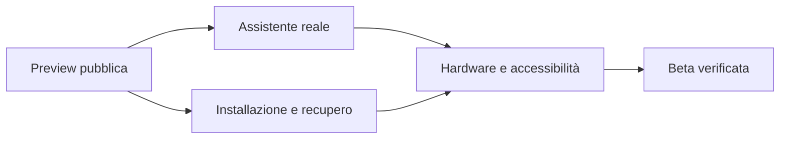

# Roadmap pubblica

L'obiettivo è un desktop aperto che si possa usare, capire e riparare. La priorità è rendere affidabili pochi percorsi quotidiani e documentare le prove. Le fasi non hanno date promesse.

| Fase | Risultato richiesto per considerarla completata |
| --- | --- |
| 1 — Preview collaborativa | Sorgenti pubblici, build documentata, issue riproducibili, CI e immagini reali |
| 2 — Assistente operativo | Runtime e modello inclusi per impostazione predefinita, inferenza offline, anteprima/conferma, recupero delle cartelle, errori e cancellazione, misure su hardware dichiarato |
| 3 — Sistema installabile | Installer su disco vuoto, cifratura, backup/ripristino, aggiornamenti e recupero provati in VM |
| 4 — Hardware e accessibilità | Matrice di macchine, sospensione/rete/audio/periferiche, tastiera e lettore schermo verificati |
| 5 — Beta per consumatori | Flussi completi, compatibilità applicativa documentata, criteri di release e supporto comunitario |

Contribuzioni iniziali: guida inglese, adattamento QA, test installer in VM, benchmark inferenza reale, navigazione da tastiera e report hardware. Una nuova integrazione di modello richiede nome/versione esatti, licenza, memoria necessaria e prove di inferenza: il nome di un modello, da solo, non è una funzionalità implementata.
