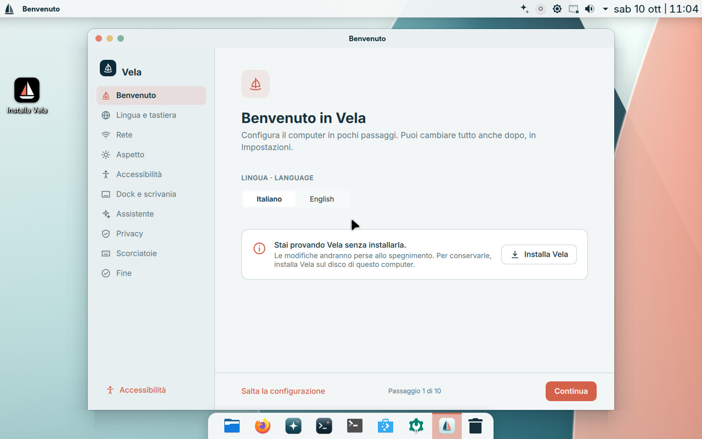
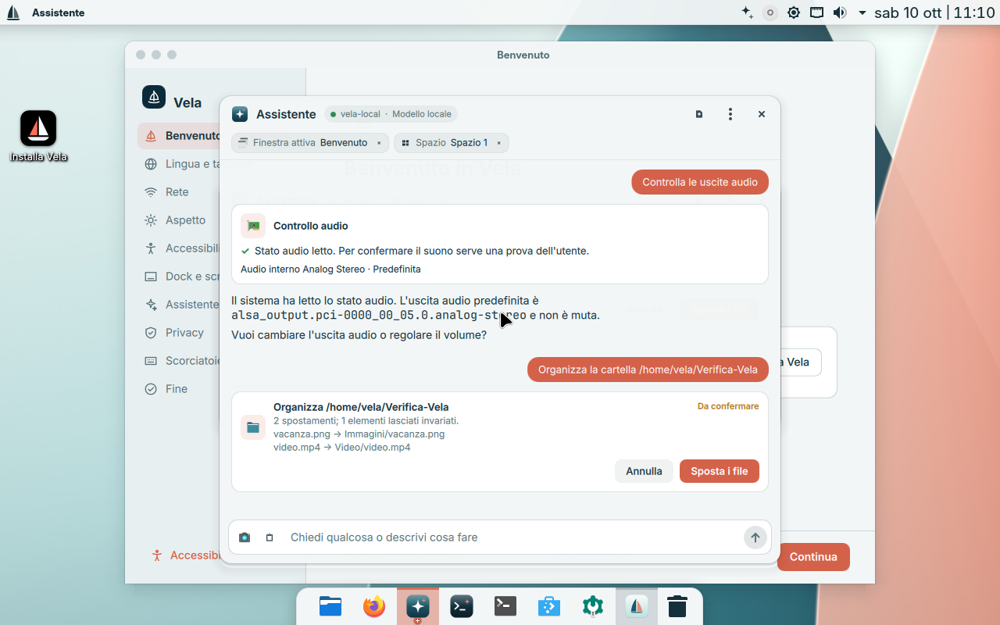
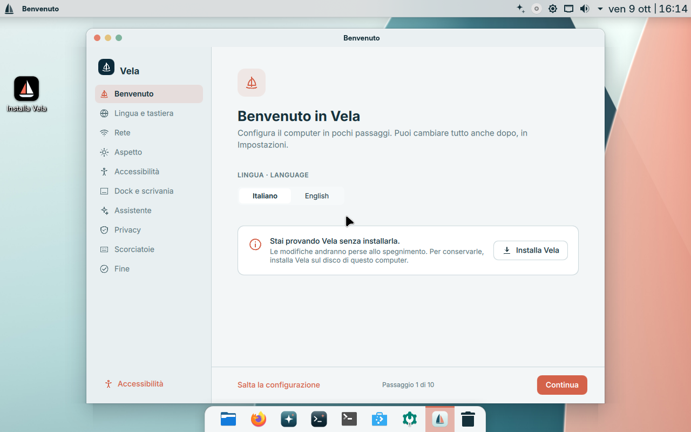
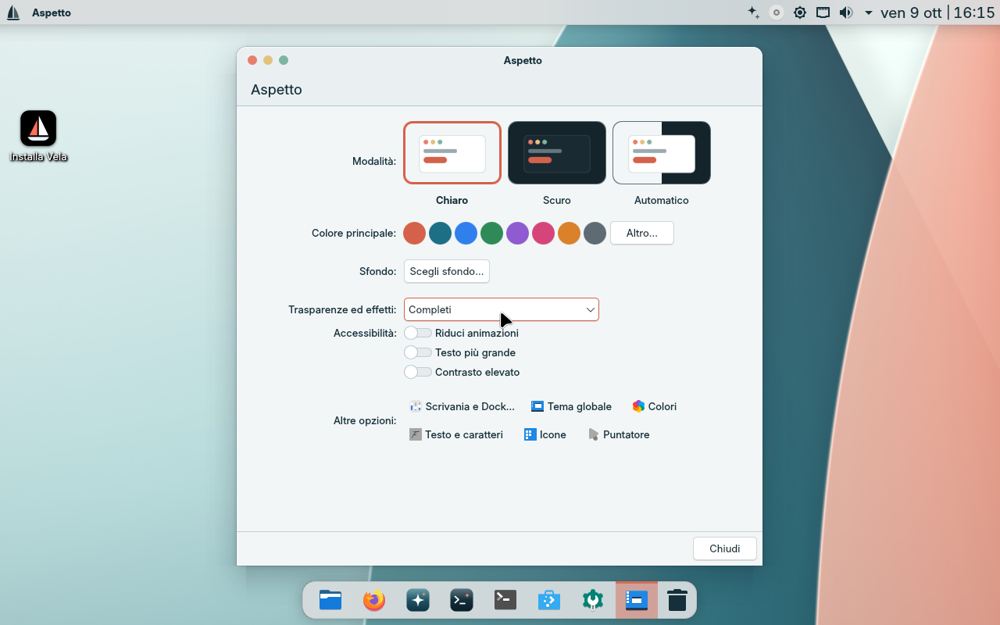
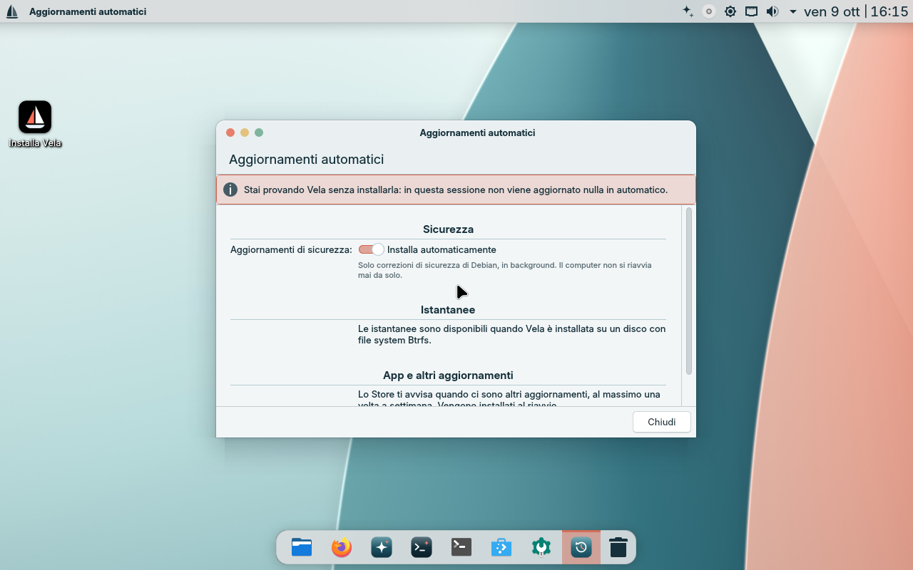

# Schermate del sistema

> **Archivio visivo della preview desktop Debian/KDE 2.x.** Queste schermate non rappresentano l'architettura M0–M2 descritta nel [README corrente](../README.md).

## Preview 2.1 locale — 10 ottobre 2026

Nuova ISO avviata in VirtualBox con 8 GB di RAM, 4 CPU e cavo di rete scollegato. Il pannello mostra una diagnosi audio ottenuta con il modello Gemma incluso. La lettura delle uscite non dimostra che il suono sia udibile.

Il riordino mostrato è un comando esplicito riconosciuto dal pannello: prepara
un'anteprima senza inferenza. La prova separata del modello reale sul riordino
è documentata nel [rapporto](VERIFICATION_LOCAL.md).

## Schermate storiche della preview 2.0

## Preview 2.1 locale — 10 ottobre 2026

Nuova ISO avviata in VirtualBox con 8 GB di RAM, 4 CPU e cavo di rete scollegato. Il pannello mostra una diagnosi audio ottenuta con il modello Gemma incluso. La lettura delle uscite non dimostra che il suono sia udibile.

## Schermate storiche della preview 2.0

Schermate reali di VelaOS 2 integrato in VirtualBox, 9 ottobre 2026. `welcome`, impostazioni, privacy, aspetto e aggiornamenti provengono da R2; Store e pannelli assistente/terminale dalla build integrata immediatamente precedente. Non dimostrano inferenza reale.

## Primo avvio

## Assistente — tema scuro

## Privacy

## Aspetto

## Aggiornamenti

## Store

## Assistente e terminale

