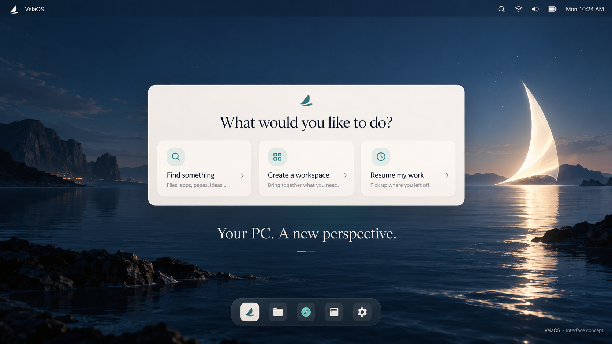
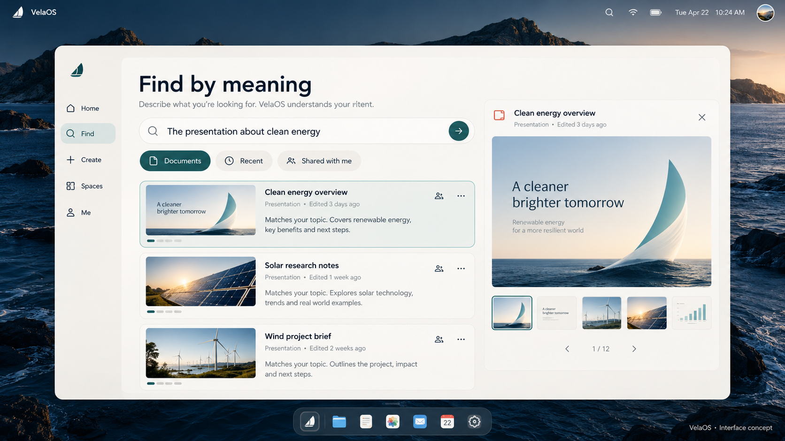
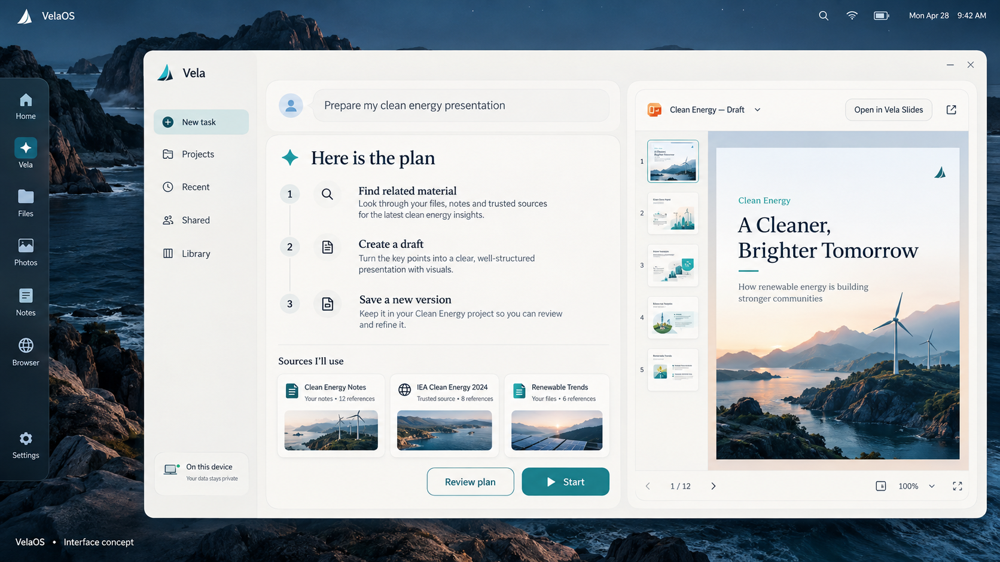
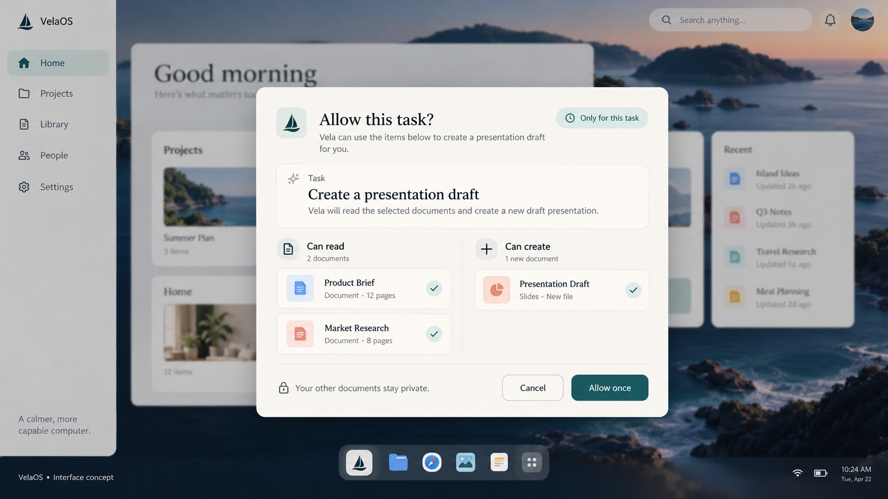
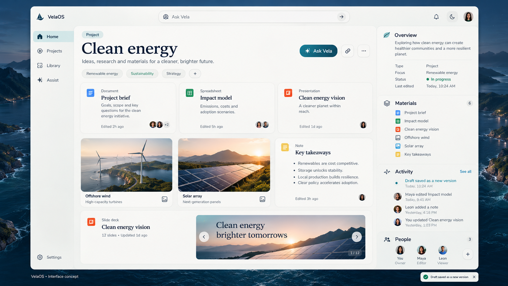
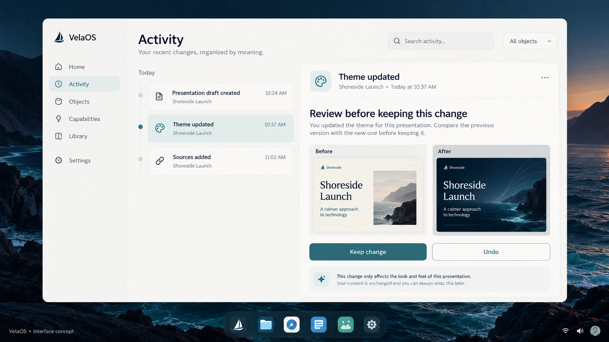
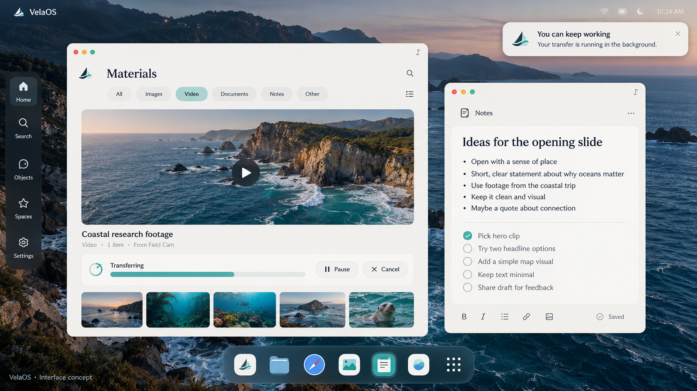
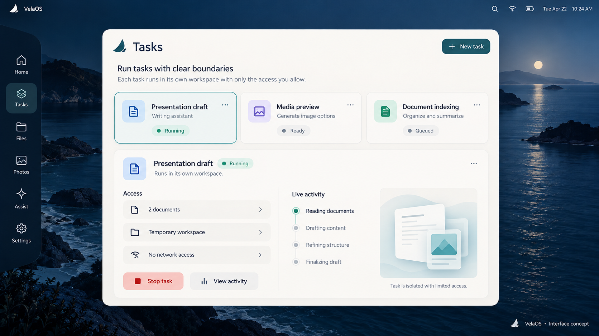
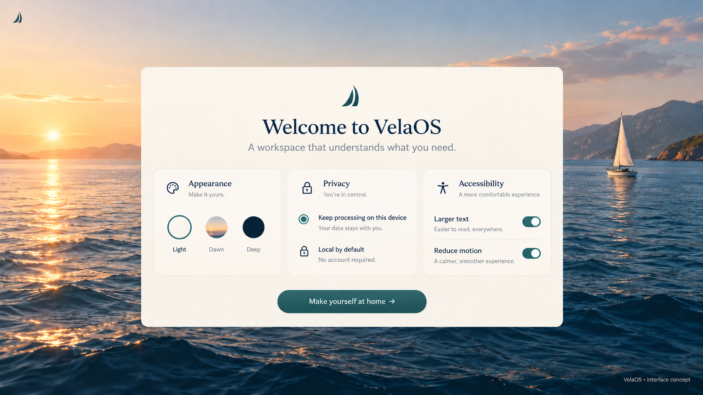
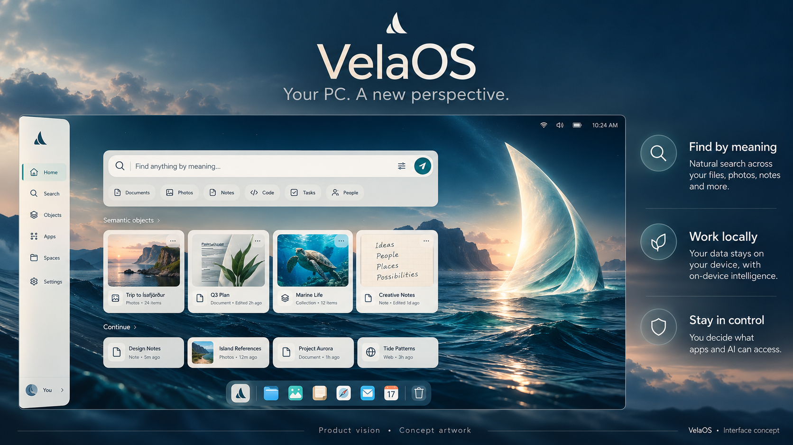

# VelaOS — Interface concepts

Your PC. A new perspective. ⛵

Dieci proposte visive per l'esperienza futura di VelaOS. **Sono concept, non screenshot di un sistema già implementato.** Testi, dati, app e contenuti nelle immagini sono esempi illustrativi. Queste tavole non attestano prestazioni, RAM, sicurezza o completamento dei gate.

Le immagini propongono l'esperienza utente; i dettagli grafici variano tra le tavole e non costituiscono ancora un design system definitivo. Nessuna struttura a cartelle nell'implementazione LFS è proposta dagli eventuali pittogrammi convenzionali delle immagini.

## 01 — Desktop e ricerca centrale

Una home tranquilla con azioni per trovare materiali, creare uno spazio e riprendere il lavoro.

## 02 — Ricerca per significato

Descrivere un documento anziché ricordarne il percorso: risultati con anteprima e contesto.

## 03 — Assistente locale e piano

Una richiesta diventa un piano visibile con fonti, revisione e avvio esplicito.

## 04 — Permessi per il singolo task

Accesso circoscritto ai documenti selezionati, con approvazione una tantum.

## 05 — Spazio di progetto

Documenti, note, media e bozze raccolti per contesto, senza albero di percorsi.

## 06 — Cronologia e annullamento

Confronto prima/dopo per decidere se mantenere o annullare una modifica.

## 07 — Trasferimenti in background

Un oggetto multimediale viene trasferito mentre l'utente continua a scrivere.

## 08 — Task isolati e accessi

Attività in corso, ambito degli accessi e possibilità di fermare un task.

## 09 — Benvenuto, privacy e accessibilità

Elaborazione locale predefinita, aspetto, testo più grande e movimento ridotto.

## 10 — Copertina GitHub

La visione pubblica: trovare per significato, lavorare in locale, restare in controllo.

