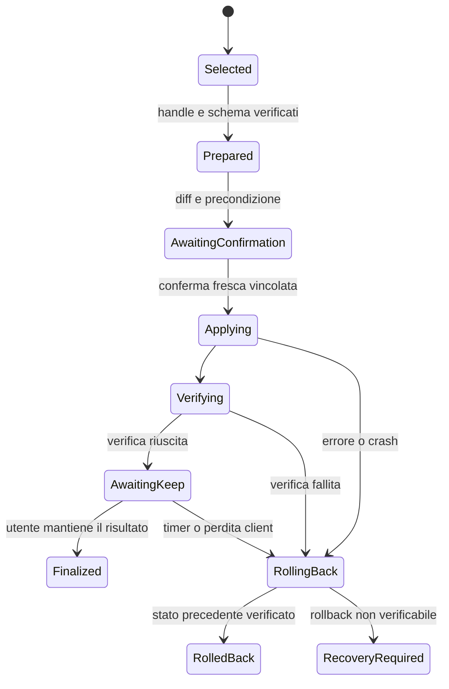

# M4 — SAVE, RECALL, RESTORE

Stato: progetto di integrazione. Ingresso eseguibile solo dopo M2 e M3 verificati. Nessuna modifica alla configurazione attiva viene effettuata dalla documentazione.

## Perimetro iniziale

Un dominio: `vela.net.config.v1`, limitato ai campi realmente ammessi dal kernel M1 (`schema`, `ssid`, `dns`). VPN, interfacce aggiuntive e nuovi campi richiedono schema versionato, extractor, validazione e migrazione prima di essere promessi. Le richieste non supportate devono risultare Unsupported, non dati inventati.

LFS diventa un servizio Neural Bus con manifest: put, recall, open e list. Il kernel Rust esistente rimane implementazione interna del servizio; i client non lo invocano per bypassare Envelope e capability. M0 entra come indice semanticamente filtrato per scope **prima di scoring**, con epoch fisso, recovery dal log e upsert idempotenti. La bridge Python M0 resta evidenza sperimentale; l'integrazione finale richiede il servizio Rust previsto e un gate di regressione equivalente.

Il provider di stato attivo può avere un adapter host privato, ma l'API Vela resta snapshot/prepare/apply/verify/rollback con risorse tipizzate. Un provider in memoria è utile per test ed è etichettato fixture: non dimostra restore reale del dispositivo. L'adapter qualificato non imposta SSID o DNS che il suo schema non sa rappresentare.

## SAVE

1. Ingress autentica l'Envelope, risolve il contesto senza inferire uno stato assente.
2. M3 propone snapshot → put; Rust valida e attenua read sul provider e write sul tipo LFS.
3. Il provider emette un payload esatto su M2; byte fuori dal planner.
4. LFS valida lo schema, canonicalizza, calcola OID, cifra e registra il commit durevole con idempotency key.
5. L'aggiornamento dell'indice segue il commit. Un ritardo di indicizzazione è esplicito; list mantiene il nuovo oggetto raggiungibile. La ricevuta non confonde «committed» con «già ricercabile semanticamente».
6. Reply con OID, commit_id e titolo; nessuna configurazione attiva modificata.

## RECALL

Query tipizzata con kind, periodo e facets. Il servizio filtra per caller prima di ANN/BM25, fonde e applica il reranker previsto quando qualificato. Un punteggio non basta a emettere One: la soglia deve essere calibrata su corpus separato, con precisione di auto-resolve misurata. Fino a tale prova si restituiscono candidati e selezione esplicita.

One contiene handle read-only, caller-bound, TTL ≤120 s. Ambiguous propone card con score e facets, senza rendere oggetti altrui osservabili. Empty offre list autorizzato. Ogni oggetto deve essere raggiungibile tramite list in massimo tre passaggi; un miss semantico non deve sembrare perdita di dati.

## RESTORE: macchina a stati durevole

**Prepared:** snapshot del precedente stato attivo salvato in LFS; target aperto con hash verificato; schema e diff deterministici; precondizione sulla revisione del provider. Journal firmato con operation_id, target OID, previous OID, principal e stato. Nessun segreto in UI.

**Conferma:** esplicita, monouso, vincolata a principal, operation_id, hash del piano/diff e revisione attuale; TTL iniziale 120 s. Le parole «sì» presenti in contenuti salvati non sono conferma. Il modello non può produrla. Uno stato cambiato nel frattempo invalida diff e conferma: serve nuova preparazione.

**Applying:** intent idempotente al provider con capability write attenuata e quota. Il journal dell'intento e il materiale di rollback sono durevoli **prima** dell'effetto esterno. Non c'è transazione atomica magica tra redb e dispositivo: il recovery riconcilia ogni finestra di crash con stato reale e operation_id.

**Verifica e timer:** osservazione indipendente del provider; timer iniziale 30 s dopo applicazione. L'utente può mantenere la modifica soltanto dopo verifica positiva. In assenza di Keep, client perso o revoca che impedisce nuove azioni, il coordinatore esegue il rollback con authority interna dedicata, prelimitata al ripristino dell'operazione; mai una capability generica affidata al planner.

**Recovery:** su riavvio ogni operazione non Finalized viene riconciliata prima di nuovi restore nello stesso dominio. Un clock incerto non estende il timer: ripristino conservativo. Monotonic clock durante la sessione, deadline durevole e regole di reboot esplicite. La revisione del provider evita di sovrascrivere alla cieca una modifica concorrente; conflitto → RecoveryRequired con spiegazione, non «rollback riuscito».

**Risultato:** Finalized e RolledBack richiedono verifica del provider e ricevuta firmata. RecoveryRequired blocca nuovi apply nel dominio finché lo stato non è riconciliato. «Restore» non cancella la storia LFS; il rollback riguarda l'effetto sullo stato attivo.

## Contratti da stabilizzare prima di M4

Envelope versionato, IntentPlan, reply One/Ambiguous/Empty, registry/schema, handle, route, signal e journal di apply. Scadenza/revoca e riferimenti sono host-side. I payload restano sul data plane tipizzato; card e diff ridotti sono control metadata, non trasporto di file nel prompt.

Checklist di integrazione: servizio LFS persistente; secret provisioning reale; manifest autenticati; epoch planner separato da epoch embedding; cache invalidabile; bus dual-lane qualificato; Wasm/authority con host calls ristrette; client che rende selezione, diff, conferma e ricevuta; provider con verifica e rollback reali.

Fonti: specifica VelaOS §§3–5 e roadmap pagina 14; [boundary Wasmtime](https://docs.wasmtime.dev/security.html). Un sandbox limita accessi del task, non rende automaticamente transazionali gli effetti esterni.
