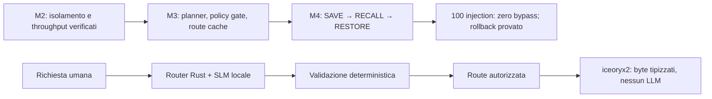

# M3 → M4: control plane e integrazione verificabile

Stato: **progetto tecnico, non implementazione né gate chiuso**. Data: 2026-10-10.

Questo pacchetto definisce il planner M3 e il primo flusso completo M4. Lo sviluppo eseguibile procede dopo la chiusura dei prerequisiti M2. La preparazione dei contratti e dei test può avvenire in parallelo, senza alterare il data plane in sviluppo.

## Deliverable

| Documento | Contenuto |
| --- | --- |
| [Intent Router](INTENT_ROUTER.md) | Confini, contratto del piano, cache e autorità. |
| [Kernel Prompt](KERNEL_PROMPT.md) | Prompt normativo del compilatore semantico e regole di assemblaggio. |
| [Memoria e VRAM](MEMORY_PROTOCOL.md) | Residenza del modello, quote, misurazioni e fallback espliciti. |
| [M4 end-to-end](M4_E2E.md) | SAVE, RECALL, RESTORE, conferma, rollback e recovery. |
| [Gate e prove](GATES.md) | Criteri del PDF, benchmark da congelare e matrice di attacco. |
| [Decisioni](DECISIONS.md) | Scelte iniziali, dipendenze e stato delle evidenze. |

## Allineamento alla specifica

La roadmap grafica del PDF, pagina 14, assegna **M3 a Planner / gate / route cache**, **M4 a SAVE / RECALL / RESTORE end-to-end**, e M5 al port seL4. Il precedente titolo pubblico «M3 — Sistema integrato» viene precisato di conseguenza, senza cambiare i criteri tecnici.

M3: 100% piani validi; correttezza >95% su 300 intent; cold <400 ms. M4: zero bypass su 100 injection; rollback funzionante. Non sono risultati già ottenuti. Le soglie esatte e il protocollo di misura sono in [GATES](GATES.md).

## Sei invarianti conservati

1. OID = BLAKE3 del plaintext canonico; embedding e modello non definiscono identità.
2. Il modello propone soltanto. Policy e servizi Rust autorizzano deterministicamente.
3. Il control plane risolve un intento; il data plane trasporta byte via iceoryx2 senza inferenza.
4. Query semantiche restituiscono candidati; soltanto un handle autorizzato apre byte esatti.
5. Scritture immutabili e log firmato; applicazioni allo stato attivo richiedono conferma e rollback.
6. Epoche di embedding fissate; cambiare modello richiede migrazione esplicita.

Le risorse utente hanno OID, query e handle, non nomi gerarchici. I collegamenti ai file di questo repository servono soltanto alla documentazione dello sviluppo.

## Base osservata

Il pacchetto parte da `main` al commit `4a4de8f` (PR #5 merged). Nel checkout M2 parallelo sono stati osservati `sandbox.rs` e `authority.rs`, con ultimo commit `53a873d`. Non vengono importati, modificati o certificati da questa PR. Il dual-lane, il collegamento Wasm/authority e la chiusura completa M2 devono fornire propri report. Nessun test runtime M3/M4 è stato eseguito per questi documenti.
