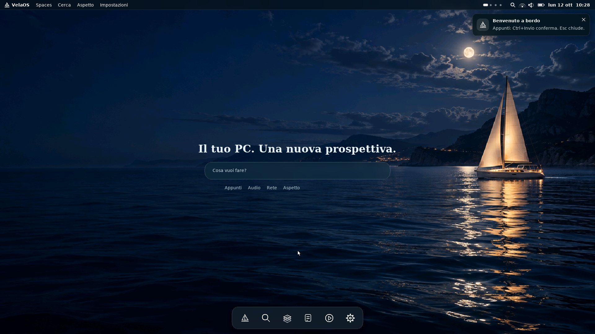

# VelaOS — native Glass preview

A bootable x86_64 preview of the Zero-App visual direction: a photographic sea wallpaper, familiar toolbar, and small frosted surfaces that appear for a single intent and close when finished. These are screenshots of the running guest, not interface concept renders.

## Start in VirtualBox

Run `Start-VelaOS-VirtualBox.ps1`. It opens `dist/velaos-glass-x86_64.iso` in the VM `VelaOS-Glass`, with 512 MB RAM, BIOS (EFI off), Other/Unknown 64-bit, PS/2 keyboard and mouse, VBoxVGA and one CPU. Right Ctrl releases input capture.

The older `velaos-x86_64.iso` and `.vdi` are retained as the previous scaffold. The Glass ISO and matching Glass VDI are the new artifacts. This preview is separate from the AArch64 Microkit security proof and the host Glass HTTP demonstration.

## What actually works

- Native boot through GRUB to a 1920×1080 framebuffer, no browser behind the UI.
- New photographic wallpaper and bounded RGB565 asset, frosted cards and a stable lower toolbar.
- Clean initial desktop; starting an intent does not open a conventional editor window.
- Small intent surface, deterministic Rust routing for notes/audio/network, manual entry points.
- `appunta idee` / `write notes`: edit a real bounded text buffer. Ctrl+Enter or **Keep draft** retains it in RAM. The confirmation closes after three seconds; Esc cancels and clears temporary buffers. Reopening Notes restores the retained session draft.
- `wifi` / `rete`: a compact unavailable-state surface. No fabricated SSIDs or connection claims.
- `riproduci audio` / `play audio`: a player-shaped unavailable-state surface. No simulated codec or fake playback timer.
- Themes, English/Italian, Spaces and manual appearance controls from the existing shell. Italian and Deep are the defaults in this preview.

## Boundaries

The intent matcher is bounded native Rust, not an LLM. The old framebuffer/PS2 renderer is C; new surface classification/lifecycle logic is Rust `no_std`, without allocation or authority minting. This image has no process scheduler or Wasm domain lifecycle yet. Closing Glass removes UI state and clears its temporary buffers; it does not prove process-domain destruction or memory returning to zero. The resident renderer and system buffers remain.

Notes are **not saved to disk**, not sent through Biscuit/PCB/LFS, and have no cryptographic receipt. Audio decoding, networking, semantic recall, dynamic generation of validated component schemas, persistent storage and the secure data-plane integration remain open. The interfaces state these limitations. The displayed VM memory capacity is not a measured working set.

## Build

Use Rust 1.96.1 with `rustup target add x86_64-unknown-none`, GCC, NASM, GRUB BIOS tools, xorriso, Python/Pillow and the DejaVu/JetBrains Mono fonts, then `make` in this directory. The Makefile links a Rust static library into the existing native renderer. Source wallpaper pixels are packed by `python3 tools/pack_wallpaper.py`; the committed packed asset allows normal builds without regenerating it.

On Windows, Rust can cross-compile the static library directly using the command in the Makefile; the GCC/GRUB stage can run in WSL. The native Glass CI performs a clean Linux build with the pinned Rust toolchain.

## Verification

- Rust tests cover bounded intent classification, unknown requests, cancellation of every surface and refusal to retain non-note tasks.
- `python3 tools/smoke_glass.py build/velaos-x86_64.iso build/verification` boots a real QEMU guest, types an intent and note, confirms the RAM draft, closes, opens a network surface and cancels. It checks guest serial markers and captures the actual framebuffer.
- VirtualBox boot, keyboard intent → note input → Ctrl+Enter confirmation were exercised at 512 MB. See `GLASS_VALIDATION.md` for the artifact hashes, evidence and limitations.

The visual direction is implemented as a preview. This is not a completed consumer OS or a qualified security boundary.
