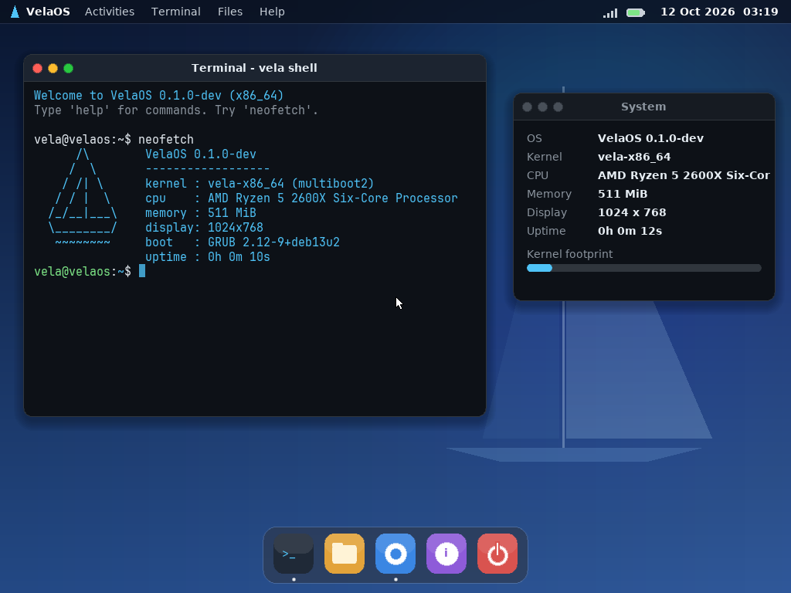

# VelaOS native x86_64 (VirtualBox ISO)

This folder builds **a real bootable operating system image**: a small x86_64 kernel written
for VelaOS, loaded by GRUB, that owns the screen, keyboard and mouse of the virtual machine
and draws the Vela desktop itself (top bar with clock, dock, windows, terminal shell).
There is **no Linux, no browser and no host web page** underneath it.

> **Status: neutral scaffold.** This is the boot-to-pixels base for the OS shell described in the
> VelaOS OS vision brief. Final theme, dock style, caption controls and first-boot welcome wait for
> the section 7 variant decisions; the look here is deliberately minimal and will change.

| File | What it is |
|------|------------|
| `dist/velaos-x86_64.iso` | Bootable ISO (BIOS). Attach it to a VirtualBox VM. |
| `dist/velaos-x86_64.vdi` | Same system as a VirtualBox disk (optional alternative to the ISO). |
| `screenshots/vbox-*.png` | First boot captured **inside VirtualBox 7.2** (splash + desktop). |
| `Start-VelaOS-VirtualBox.ps1` | One command: creates the VM and boots the ISO on Windows. |



## Quick start on Windows (one command)

1. Install VirtualBox 7.x (https://www.virtualbox.org/).
2. Open PowerShell in this folder (`os/x86_64`) and run:

   ```powershell
   powershell -ExecutionPolicy Bypass -File .\Start-VelaOS-VirtualBox.ps1
   ```

That creates a VM called `VelaOS-x86_64` and starts it.

## Manual VirtualBox steps (no script)

1. **New VM**: VirtualBox → *Machine* → *New*.
   - Name: `VelaOS`
   - ISO Image: leave empty (attach below) — or pick `dist/velaos-x86_64.iso` and tick *Skip Unattended Installation*.
   - Type: **Other**, Version: **Other/Unknown (64-bit)**.
2. **Hardware**: Memory **512 MB** (256 MB is enough), 1 CPU. **Do not** enable EFI.
3. **Hard disk**: *Do Not Add a Virtual Hard Disk* (the ISO is a live system).
   (Alternative: *Use an Existing Virtual Hard Disk File* → `dist/velaos-x86_64.vdi`.)
4. **Settings → Display**: Graphics Controller **VBoxVGA** (VMSVGA also works), Video memory 32 MB or more.
5. **Settings → System → Motherboard**: Pointing Device **PS/2 Mouse**, *Enable EFI* **off**.
6. **Settings → Storage**: click the empty optical drive → disc icon → *Choose a disk file…* → `dist/velaos-x86_64.iso`.
7. **Start**.

### What you should see

1. **GRUB menu** (blue): `VelaOS 0.1 (x86_64)` — boots automatically after 3 seconds.
2. **Splash**: black screen, blue sail logo, the word **VelaOS** and a progress bar
   (`Starting kernel… → Probing devices… → Mounting system… → Starting desktop…`).
3. **Desktop**: blue sea-gradient wallpaper with a sail, a top bar (**VelaOS**, menus, status icons,
   date and time), a **Terminal** window, a **System** window and a **dock** at the bottom.
4. Click inside the VM window (VirtualBox captures the mouse; press **Right Ctrl** to release it).
   Type `help`, `neofetch`, `ls`, `cat README.txt`, `open files`, `theme`, `shutdown`.
   Click dock icons to open/close Files, System and About; drag windows by their title bar.

## Build from source (Linux / WSL)

```sh
sudo apt-get install -y build-essential nasm grub-pc-bin grub-common xorriso mtools python3-pil qemu-system-x86 socat
make            # -> build/velaos-x86_64.iso
make run        # optional: boot it in QEMU
./tools/qemu-shots.sh   # optional: headless QEMU boot with PNG screenshots
```

Make a VDI from the ISO (Windows): `VBoxManage convertfromraw dist\velaos-x86_64.iso dist\velaos-x86_64.vdi --format VDI`
(the ISO is hybrid, so it also boots as a disk).

## Why this path

Classic VirtualBox virtualises x86 only, so the seL4 Microkit AArch64 build used by the
QEMU executor gate cannot be the VirtualBox deliverable. The shortest path to "boots in
VirtualBox and looks like an OS" is a native x86_64 kernel booted by GRUB with a linear
framebuffer. The seL4 executor gate (`make e2e`) stays as a separate QEMU AArch64 check;
the Windows `launch-glass.bat` demo stays an optional host demo.

## Limits (honest)

- Kernel uses polling, no interrupts, no scheduler, no processes, no storage driver yet:
  files in *Files* / `ls` are built-in sample content, nothing is saved.
- BIOS boot only (no EFI), resolution fixed at 1024×768×32 by GRUB.
- PS/2 keyboard (US layout) and PS/2 mouse only. USB tablet pointing device is not supported.
- The clock shows the VM RTC (VirtualBox: host local time; QEMU: UTC).
- `shutdown` uses the VirtualBox/QEMU ACPI ports; on other hardware close the window.
- Glass and the seL4 executor are not inside this image yet; that is the next step once boot is stable.
