# M2 — Neural Bus bridge e boundary Wasmtime (in corso)

Verified locally on Windows on 2026-10-10. This is a real Rust `iceoryx2::ipc::Service` experiment between separate processes, not an IPC mock. **M2 remains open.** See [actual measurements](bridge-results.json).

## Fase 1: Wasm boundary

`src/sandbox.rs` aggiunge un runtime Wasmtime component-model con l'interfaccia WIT [`task.wit`](wit/task.wit): `run(input: string) -> result<string, string>`. Il runtime imposta un limite di memoria privata configurabile tra 16 e 64 MiB, fuel per task e un massimo globale di due esecuzioni concorrenti. Il `Linker` è creato vuoto: non vengono registrati WASI, filesystem, rete o altre capability host. Le importazioni non risolte falliscono durante l'istanza.

**Stato di verifica:** il workflow [Neural Bus M2 CI](../../.github/workflows/neural-bus-m2.yml) passa su Windows: formattazione, compilazione, test del crate/sandbox, Clippy e build del fixture. Il build locale Wasmtime non ha restituito un exit code conclusivo. La CI verifica i test base sui limiti di memoria e sugli slot concorrenti, non un attacco completo al sandbox. Il boundary non è collegato alla bridge o a un planner.

## Obiettivi M2 ancora aperti

- Lane fast per messaggi sotto 4 KiB e lane bulk asincrona con blocchi da 256 KiB e 8 crediti per stream (2 MiB in volo); il protocollo bulk non è implementato.
- Gate prestazionale: oltre 100.000 messaggi/s da 4 KiB e p99 sotto 100 µs, misurando separatamente round-trip e latenza unidirezionale.
- Coesistenza con stream lento di almeno 10 GB e regressione della lane fast non superiore al 20% rispetto alla baseline.
- Isolamento avversariale dei task, handle opachi e capability Biscuit attenuate validati end-to-end.
- Obiettivo complessivo del sistema: meno di 1,5 GB RAM a riposo; non ancora misurato.
- Writer temporaneo LFS per file grandi, cifratura chunked, verifica progressiva e commit sul BLAKE3 del plaintext canonico.

## Verified flow

```mermaid
flowchart LR
  LFS["M1: capability-authorized semantic cards"] --> Recall["M0: pinned embedding + BM25 + RRF"]
  Recall --> Candidates["Ranked OIDs; auto_resolve=false"]
  Candidates --> Select["Explicit fixture selection"]
  Select --> Policy["Rust: Biscuit + authenticated route"]
  Policy --> Handle["M1: exact handle and open"]
  Handle --> Loan["Typed shared-memory loan"]
  Loan -->|"iceoryx2 data plane"| Receiver["Separate receiver: type, sequence, MAC, digest"]
```



Five real `vela.net.config.v1` objects are admitted through M1. Their extracted cards are searched by the existing M0 adapter. The exact CafeGuest-5G candidate is selected explicitly, then opened through M1's caller-bound handle. Its 69 canonical bytes arrive in another process with a verified digest. A separate synthetic 4 KiB payload is transferred 10,000 times.

The control plane carries cards, OIDs, policy and endpoint credentials. Bulk object bytes and acknowledgments use typed iceoryx2 channels. No LLM is invoked. Objects are addressed by OID and handle, never hierarchical paths. Host backing storage and executable locations in this development fixture are implementation artifacts, not LFS names.

## Results and boundaries

- 10,000 authenticated 4 KiB transfers: 62,222.68 messages/s; round-trip p99 17.0 µs; matching receiver digest.
- These are sequential ping/ack measurements, including frame authentication, not pipelined throughput or one-way latency. The M2 threshold of >100,000 messages/s has **not** been established.
- Transport uses loaned typed frames and borrowed receiver slices. Decrypting an LFS object into a buffer and staging it into a loan still copies bytes; end-to-end storage zero-copy is not claimed.
- Tests reject wrong caller/schema, attenuated rights, altered routes, expired routes/endpoints, modified payloads and unexpected sequence numbers. Formatting, all-feature Rust tests and Clippy with warnings denied pass locally.
- The original mixed-kind M0 benchmark and this all-NetConfig bridge use different five-object fixtures. M0's closed gate does not establish bridge-wide semantic quality.

## Security boundary

This fixture runs trusted native processes under one Windows account. Biscuit checks occur in Rust before issuing a short-lived MAC-protected route. Endpoint credentials are handed to the child over trusted control input and are never included in the report. Native IPC peer identity, operating-system read isolation, read-only subscriber enforcement and Wasmtime sandboxing are **not proven**. The symmetric endpoint key allows a compromised authorized receiver to forge frames; it is not a production sender identity. ACKs are unauthenticated fixture synchronization, not an authority channel. Frame MACs do not encrypt shared-memory payloads. Descriptor replay/clock-reset protection is also unfinished.

Only the `fixture-e2e` feature enables the executable and synthetic M1 credentials. Production root-key provisioning and protected endpoint delivery remain required. Route expiry stops subsequent frame operations; immediate token revocation is not implemented.

## Reproduce on the development host

Use the M0 environment/model cache prepared by [M0](../m0/README.md). From the repository checkout, using PowerShell:

```powershell
cargo test --manifest-path poc/m2/Cargo.toml --all-features --locked
cargo clippy --manifest-path poc/m2/Cargo.toml --all-features --all-targets --locked -- -D warnings
cargo build --manifest-path poc/m2/Cargo.toml --release --features fixture-e2e --locked
& poc/m2/target/release/bus-spike.exe poc/m0/.venv/Scripts/python.exe poc/m0/bridge_recall.py poc/m2/bridge-results.json 10000
```

Python remains confined to the existing M0 retrieval experiment. New bus, policy, frame authentication and LFS byte operations are Rust. This bridge does not yet expose a persistent Rust semantic-index service.

## Next M2 work

1. Bind peers to protected runtime identities and enforce source/sink permissions at the memory boundary; test unauthorized attachment, forged frames and expired descriptors across processes.
2. Replace fixture endpoint provisioning with protected credentials and enforce sender-only authority, replay protection and authenticated acknowledgments.
3. Add bounded backpressure, cancellation, receiver failure cleanup and chunked transfers larger than 4 KiB.
4. Run an independent pipelined 4 KiB benchmark with warm-up, repeatable load and latency distributions against the specification's M2 thresholds.
5. Integrate the semantic index into the Rust LFS/control service with pinned epochs and explicit candidate selection; retain deterministic authority checks outside model planning.

The fixed-layout frame is a prototype wire type, not a frozen public ABI. `NetConfigV1` represents the admitted M1 schema; `Bulk4KiB` is benchmark-only. Only LFS → viewer routes are admitted. M2 closure requires performance and isolation evidence beyond this bridge.
